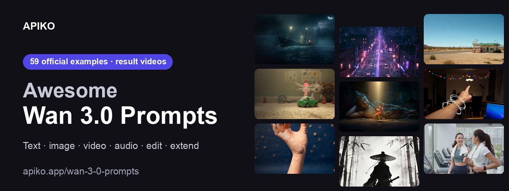

<div align="center">

<a href="https://apiko.app/zh/wan-3-0-prompts?utm_source=github&utm_medium=banner&utm_campaign=awesome-wan-3.0-prompts"></a>

[](LICENSE)
[](#menu)
[](https://apiko.app/zh/models/wan3.0-text-to-video?utm_source=github&utm_medium=badge&utm_campaign=awesome-wan-3.0-prompts&utm_content=model_try)
[](https://apiko.app/zh/docs/api-manual/video-series/wan3.0/wan3.0-overview?utm_source=github&utm_medium=badge&utm_campaign=awesome-wan-3.0-prompts&utm_content=docs)

[](README.md)
[](README_zh-CN.md)
[](README_zh-TW.md)
[](README_ko.md)

</div>

# Awesome Wan 3.0 提示词

<a id="introduction"></a>
## 🌟 简介

**59 条提示词，全部来自阿里通义万相官方《Wan3.0 视频创作者手册》，每条附成片视频。**

按用途分类：从纯文字生成视频，到图片、视频、音频参考，再到编辑和延长已有视频。找一条接近你想要的镜头，复制后只改需要改的部分。所有成片和原视频都能在 GitHub 页面上直接播放。

在线搜索和筛选： [apiko.app/wan-3-0-prompts](https://apiko.app/zh/wan-3-0-prompts?utm_source=github&utm_medium=readme&utm_campaign=awesome-wan-3.0-prompts&utm_content=intro).

> [!NOTE]
> 中文提示词是手册原文，英文、繁体中文和韩文版本是翻译。

<a id="quick-start"></a>
## 🚀 快速开始

**网页上用：** 每条都有「在 APIKO 运行」链接，会在 [apiko.app](https://apiko.app/zh/wan-3-0-prompts?utm_source=github&utm_medium=quickstart&utm_campaign=awesome-wan-3.0-prompts&utm_content=browser) 打开这条示例；点「使用」，提示词和参考素材就会填进 Wan 3.0 试用台。

**用 API：** 先创建 [APIKO API Key](https://apiko.app/zh/dashboard/apikeys?utm_source=github&utm_medium=quickstart&utm_campaign=awesome-wan-3.0-prompts&utm_content=api_key)，再创建任务并轮询，直到视频生成完成。参考图、视频和音频写在请求体里，见[常见问题](#faq)。

```bash
export APIKO_API_KEY="your_key_here"

TASK_ID=$(curl https://api.apiko.app/v1/videos \
  -H "Authorization: Bearer $APIKO_API_KEY" \
  -H "Content-Type: application/json" \
  -d '{
  "model": "wan3.0-text-to-video",
  "duration": 5,
  "resolution": "720p",
  "aspect_ratio": "16:9",
  "prompt": "A paper boat drifting across a calm lake at sunrise, slow cinematic camera move."
}' | python3 -c 'import json,sys; print(json.load(sys.stdin)["id"])')

while :; do
  TASK=$(curl -s https://api.apiko.app/v1/videos/$TASK_ID \
    -H "Authorization: Bearer $APIKO_API_KEY")
  printf '%s\n' "$TASK"
  printf '%s' "$TASK" | grep -qE '"status": *"(completed|failed)"|"error": *\{' && break
  sleep 5
done
```

接口: `POST https://api.apiko.app/v1/videos` (创建任务) · `GET https://api.apiko.app/v1/videos/{id}` (查询状态并读取 `video_url`)

<a id="how-to-write"></a>
## ✍️ Wan 3.0 提示词怎么写

四种写法，改写自官方手册。

- **基础公式** · `主体 + 场景 + 运动` — 谁或什么，在哪里，做什么。第一次上手够用，也给模型留了发挥空间。
- **进阶公式** · `主体 + 场景 + 运动 + 美学控制 + 风格化 + 音效` — 补上光线、景别、视角和运镜，点明画面风格，再写声音。运动要说幅度和快慢（「缓慢地」「猛烈地」）以及产生的效果。
- **图片或首帧** · `运动 + 运镜` — 图片已经定了主体、场景和风格，只写什么在动，以及镜头怎么跟。
- **声音** · `人声 + 音效 + 配乐` — 写出每句台词或旁白并描述音色（低沉沙哑、可爱），再写音效和背景音乐。

**示例里看得到的写法**

- **长视频按时间切段。** 30 秒的提示词都拆成镜头或分段，各给一个时间范围，如「分段1[0-5秒]」「(0:00 - 0:03)」。
- **声音直接写进提示词。** 音效放在尖括号里，<脚步踩在木地板上的两声轻响>；台词放在花括号里，{走吧}。
- **素材按序号称呼。** 用「图1」「视频1」「音频1」（英文写 Image1、Video1、Audio1），序号与传入顺序一致。
- **先写改动，再锁其余。** 编辑类提示词只说一处改动，结尾交代不变的部分：「女人的动作和画面其余部分保持不变」。
- **延长时留意 30 秒上限。** 输入加输出的总长不超过 30 秒，所以 15 秒的视频最多再延长 15 秒。

<a id="menu"></a>
## 📑 目录

- [🎬 文生视频](#text-to-video) (17)
  - [毕业袍下的沉默](#text-to-video-01)
  - [空荡医院的求救](#text-to-video-02)
  - [一镜到底的爆料喜剧](#text-to-video-03)
  - [购物车冲进广告牌](#text-to-video-04)
  - [骨骼战兵与花](#text-to-video-05)
  - [暴雨海面的巨兽](#text-to-video-06)
  - [女牛仔给马加油](#text-to-video-07)
  - [湖心发光的巨型植物](#text-to-video-08)
  - [悬崖边的白裙少女](#text-to-video-09)
  - [拳击场上的疲惫出拳](#text-to-video-10)
  - [虚空前的冷笑](#text-to-video-11)
  - [飞碟带走的奶牛](#text-to-video-12)
  - [黑白棚拍的五人舞段](#text-to-video-13)
  - [毛绒宇宙逃亡记](#text-to-video-14)
  - [石窟里的飞天与金刚](#text-to-video-15)
  - [哈瓦那街头的巨型骰子](#text-to-video-16)
  - [夜宅里的涂鸦怪物](#text-to-video-17)
- [🖼️ 图片参考](#image-reference) (15)
  - [雨夜站台的告别](#image-reference-01)
  - [五位人物的头饰翻牌](#image-reference-02)
  - [蜻蜓式弹射的微型飞行者](#image-reference-03)
  - [两只猫的对称荒诞冒险](#image-reference-04)
  - [芦苇滩上的双人对决](#image-reference-05)
  - [从纸张到界面的发布动效](#image-reference-06)
  - [唇釉模特试色视频](#image-reference-07)
  - [打烊后的善意](#image-reference-08)
  - [黏土小狐狸的苹果之旅](#image-reference-09)
  - [蕾丝衬衫的午后咖啡馆](#image-reference-10)
  - [通向魔法街巷的门](#image-reference-11)
  - [三位角色的游戏PV](#image-reference-12)
  - [双女主硬切时装大片](#image-reference-13)
  - [霓虹都市光球追逐](#image-reference-14)
  - [黑松露坚果脆的产品展示](#image-reference-15)
- [🎥 视频参考](#video-reference) (3)
  - [滑板动作，换上新人物](#video-reference-01)
  - [天台咖啡，借用参考运镜](#video-reference-02)
  - [能量特效套到人物身上](#video-reference-03)
- [🎵 音频参考](#audio-reference) (3)
  - [健身房里的约练对话](#audio-reference-01)
  - [按音频节拍跳偶像舞](#audio-reference-02)
  - [窗边打电话的男人](#audio-reference-03)
- [✂️ 视频编辑](#video-edit) (15)
  - [泳池杂物清除](#video-edit-01)
  - [木桌上添一只花瓶](#video-edit-02)
  - [去掉左侧的男人](#video-edit-03)
  - [小女孩换成年轻女人](#video-edit-04)
  - [放大的帆船](#video-edit-05)
  - [去掉帽子，露出自然发型](#video-edit-06)
  - [沙滩上半埋的礁石](#video-edit-07)
  - [滑板手换成短发女生](#video-edit-08)
  - [摘掉墨镜，露出眼妆](#video-edit-09)
  - [美剧式三点布光提亮](#video-edit-10)
  - [西装男与鸵鸟互换位置](#video-edit-11)
  - [整段视频变成粘土动画](#video-edit-12)
  - [台词改成英文](#video-edit-13)
  - [参考帽子与牛仔衬衫换装](#video-edit-14)
  - [男人拿起吉他演奏](#video-edit-15)
- [⏩ 视频延长](#video-extend) (3)
  - [茶馆里的货期谈判](#video-extend-01)
  - [舞厅里的华尔兹邀约](#video-extend-02)
  - [雪林小径的回眸笑](#video-extend-03)
- [🎞️ 首尾帧](#first-last-frame) (3)
  - [水墨竹林里的刀客](#first-last-frame-01)
  - [草帽女子的回忆](#first-last-frame-02)
  - [西湖水神西子](#first-last-frame-03)
- [❓ 常见问题](#faq)
- [🔗 相关链接](#related)

<a id="text-to-video"></a>
## 🎬 文生视频

> 只靠文字写出整支视频，最长 30 秒，可含多个镜头。 · 17 条

<a id="text-to-video-01"></a>
### 1. 毕业袍下的沉默

`wan3.0-text-to-video` · 30 秒 · 16:9 · **[▶ 在 APIKO 运行](https://apiko.app/zh/wan-3-0-prompts?utm_source=github&utm_medium=case&utm_campaign=awesome-wan-3.0-prompts&utm_content=text-to-video-01#text-to-video-01)** · [手册原文](https://alidocs.dingtalk.com/i/nodes/qnYMoO1rWxrkmoj2IjExdZLBJ47Z3je9)

单人近景带手持呼吸感，视线从镜头转向手中，靠自然光塑造质感

<table>
<tr><th>成片</th></tr>
<tr><td align="center"><video src="https://github.com/user-attachments/assets/b42bdc52-406f-4a66-9dc3-26e931514feb" width="640" controls muted playsinline></video></td></tr>
</table>

**提示词:**

```text
这是一个正面的近景镜头，画面主要呈现一位年轻黑人女孩的头部和上半身，她穿着一件蓝色的毕业袍。镜头稍微偏一点点，可以看到左边还有一个人，但背景被虚化处理了，看起来很模糊。女孩正对着镜头说话，嘴巴在动，眉头稍微皱着，表情看起来有点严肃和忧虑。光线从上方照下来，把她脸上的轮廓衬托得很自然，甚至能看到皮肤真实的质感。镜头虽然固定，但带着一点点人手持拍摄时的轻微呼吸感和晃动，视线从看着前面慢慢变成了低头看手里。
```

<a id="text-to-video-02"></a>
### 2. 空荡医院的求救

`wan3.0-text-to-video` · 30 秒 · 16:9 · **[▶ 在 APIKO 运行](https://apiko.app/zh/wan-3-0-prompts?utm_source=github&utm_medium=case&utm_campaign=awesome-wan-3.0-prompts&utm_content=text-to-video-02#text-to-video-02)** · [手册原文](https://alidocs.dingtalk.com/i/nodes/qnYMoO1rWxrkmoj2IjExdZLBJ47Z3je9)

摄影机后退跟拍，脚步与呼喊音效加强紧张，淡绿冷调压住画面

<table>
<tr><th>成片</th></tr>
<tr><td align="center"><video src="https://github.com/user-attachments/assets/c00e3016-40d4-4c27-bbca-7822927b7c97" width="640" controls muted playsinline></video></td></tr>
</table>

**提示词:**

```text
一段现代悬疑风格的电影感长镜头，整个画面呈现出强烈的淡绿色滤镜风格，营造出一种基于淡绿色系的清冷氛围。在散发着冰冷白光的荧光灯下，空无一人的医院走廊呈现出低饱和的色彩与极高对比的光影关系，锐利且非人情化。镜头从护士台后方开始，一名身穿墨绿色夹克的女子猛地从走廊尽头的门后冲入，沿着对称的中心线向镜头快速跑来，摄影机流畅地向后移动。她的脚步声急促而响亮，口中焦急地呼喊。最终，她冲到台前，双手用力拍在台面上，绝望地环顾四周，发出几近崩溃的求助呐喊，声音在只有微弱设备嗡鸣的寂静中回荡。
```

<a id="text-to-video-03"></a>
### 3. 一镜到底的爆料喜剧

`wan3.0-text-to-video` · 30 秒 · 16:9 · **[▶ 在 APIKO 运行](https://apiko.app/zh/wan-3-0-prompts?utm_source=github&utm_medium=case&utm_campaign=awesome-wan-3.0-prompts&utm_content=text-to-video-03#text-to-video-03)** · [手册原文](https://alidocs.dingtalk.com/i/nodes/qnYMoO1rWxrkmoj2IjExdZLBJ47Z3je9)

一镜到底快速摇镜切换导演与艺人，表情反转配合台词节奏

<table>
<tr><th>成片</th></tr>
<tr><td align="center"><video src="https://github.com/user-attachments/assets/636ae3e4-d214-421f-9059-443260c6c23c" width="640" controls muted playsinline></video></td></tr>
</table>

**提示词:**

```text
镜头1 [0秒-30秒]
近景，平视视角，连续快速摇镜，一镜到底（单镜头连续无缝运镜）：
画面左侧是身穿黑色潮流导演马甲、戴着高档专业工作耳麦的导演，其左下方放置着一台巨大的专业电影摄像机。右侧是妆容精致、留着时尚韩式逗号刘海、身穿高定制西装的关系户小鲜肉。背景是宽敞的专业影棚拍摄现场，可见巨大的绿色幕布、数个高耸的影视级C型灯架、缠绕的电线，以及在背景中穿梭忙碌的灯光师和化妆师等工作人员。
专业影棚人工光。柔和的LED柔光箱光源从右侧洒入，将三位主角的面部均匀照亮，场景色彩饱满。背景的摄影器材与绿幕在充足的影棚灯光下投射出淡淡的阴影，呈现出真实而忙碌的现代化大制作片场质感。
镜头手持拍摄一镜到底，近景，镜头一开始，拍摄导演，导演无所谓的表情，瞥了一眼画面右侧斜前方画外的一眼关系户小鲜肉，对他下达指令，说道：“媒体故意黑你，做个表情看看”。说完后镜头快速右摇到关系户面部近景，镜头不要切镜，关系户小鲜肉，面部朝向画面左侧斜前方画外导演方向，神色自若，眼神真挚而自信。他嘴唇微动，神情专业地向对方阐述到““就这种事情来说，情绪可以有好几种”，说话时，头部伴有极其轻微的自然晃动，说完后镜头快速左摇到导演面部近景，镜头不要切镜，导演思索了一下，一边挑衅似地歪了歪头，向关系户小鲜肉说到““狗仔爆料你深夜幽会”，导演说完台词后，镜头迅速右摇到小鲜肉面部近景，不要切镜，关系户小鲜肉，面部朝向画面左侧斜前方画外导演方向，并快速进入表演状态，他眉头紧锁，眼神慌乱、焦急地快速游移，随后他狠狠地咬紧下唇，闭上双眼，整张脸（虽带着精致妆容）因极度的焦虑而紧绷，完美呈现出面对偶像生涯毁灭时，内心惊恐、紧张交织的挣扎状态。表演完后， 镜头再次迅速左摇到导演近景，不要切镜，导演面部表情微变，语速加快，说到““媒体又帮你洗白了，说那是你亲姐！”导演说完后，镜头再次迅速右摇到小鲜肉近景，镜头不要切镜，镜头中，关系户小鲜肉，面部朝向画面左侧斜前方画外导演方向，他的表情在千分之一秒内完成神级转换。他先是面部一滞，随后双眼猛地眯起，嘴角极大程度地咧开，露出一排白皙的牙齿，展露出一个极其夸张、甚至有些变形的狂喜笑容。这种“星途尽毁的绝望”与“彻底摆脱束缚”交织的疯魔情绪在他脸上扭曲呈现。角色表演完后，镜头再次迅速左摇到导演近景，镜头不要切镜，导演说到“你亲姐向媒体透露，你是领养的”，导演说完后，镜头再次迅速右摇到小鲜肉近景。镜头不要切镜，镜头内，关系户小鲜肉面部朝向画面左侧斜前方画外导演方向，只见他双眼暴睁，眼球凸出，精心修剪的眉毛高高扬起，嘴巴震惊地张成“O”形。紧接着，他的嘴角再次无法克制地向上拉扯，露出一副不可思议、惊魂未定却的复杂神态。 角色表演完后，镜头再次快速左摇到导演近景，镜头不要切镜，紧接着导演露出有点惊讶的表情说到“其实你是千亿豪门真少爷”。导演说完，镜头再次随即迅速右摇到小鲜肉近景，镜头不要切镜，镜头内，关系户小鲜肉面部朝向画面左侧斜前方画外导演方向，他瞬间爆发出极度魔性的狂喜。他整个人激动得微微颤抖，双眼笑得眯成了一条缝，双手甚至抬起至胸前，双手小幅度快速连续鼓掌，身体前倾摇晃，将一夜暴富、无法自持的癫狂喜悦演绎得淋漓尽致。 角色表演完后，镜头再次快速左摇到导演近景，镜头不要切镜，导演说到“你姐卷款跑路”导演说完，镜头再次迅速右摇到小鲜肉近景。小鲜肉面部朝向画面左侧斜前方画外导演方向，只见他的双眼再次瞪大，瞳孔颤抖，嘴角向下耷拉，神情在一秒钟之内从天堂坠入地狱，写满了惊愕、痛苦与不知所措。画面最后定格在这个表情上。
```

<a id="text-to-video-04"></a>
### 4. 购物车冲进广告牌

`wan3.0-text-to-video` · 30 秒 · 16:9 · **[▶ 在 APIKO 运行](https://apiko.app/zh/wan-3-0-prompts?utm_source=github&utm_medium=case&utm_campaign=awesome-wan-3.0-prompts&utm_content=text-to-video-04#text-to-video-04)** · [手册原文](https://alidocs.dingtalk.com/i/nodes/qnYMoO1rWxrkmoj2IjExdZLBJ47Z3je9)

四段时间轴连续推进，少年乘购物车冲入广告牌的平面世界

<table>
<tr><th>成片</th></tr>
<tr><td align="center"><video src="https://github.com/user-attachments/assets/dcb0a3a4-6f54-4894-ab18-4d8ae7517ef6" width="640" controls muted playsinline></video></td></tr>
</table>

**提示词:**

```text
这是一段30秒电影级高强度单镜头（One-Take）视觉奇观短片，整体风格定位为“西海岸街头幻想主义”，视觉语言融合了90年代街头滑板录像的粗粝感与现代商业大片的精致质感。画面整体采用极致的“加州阳光”电影级调色，高饱和度的蓝色天空与阳光直射下的棕榈树影子形成强烈的对比，空气中弥漫着柏油马路的炙热感、购物车轮摩擦的金属声以及一种无所畏惧的青春叛逆气息。空间透视随着主角的极速滑行不断被拉长，镜头通过极低角度的跟随与极高动态的物理穿梭营造强烈的视觉冲力。

主角是一位穿着撞色条纹衫、带着黑色棒球帽的潮酷少年，神情从最初的慵懒松弛瞬间切换为冲破极限的亢奋；第二个场景的主角则是同一个少年，但他以一种“审视者”的姿态出现在现实维度。

第一个镜头 0-6s：
起幅为特写镜头，少年慵懒地躺在一辆红色铁质购物车内，背景是加州标志性的笔直大道与高耸入云的棕榈树。随着音乐节奏爆发，摄影机执行一个极速的向后拉远并下沉至地面，以极低角度紧贴车轮。少年开始在陡峭的公路上俯冲，购物车在路面上剧烈颠簸，两侧的汽车急速倒退，镜头捕捉到一种近乎疯狂的加速感。

第二个镜头 7-15s：
不切镜，摄影机像一个滑板手般紧紧贴地跟随，镜头在少年越过一个简易木质斜坡的瞬间，顺势执行一个优美的抛物线拉升。购物车腾空而起，摄影机从购物车底部穿过。此时，前方的巨型商业广告牌迅速占据整个视野，镜头以一种不可思议的“准心式”推进，直指广告牌中心。

第三个镜头 16-24s：
不切镜，少年连同购物车以一种“破裂次元壁”的方式直接嵌入了巨大的广告牌中。原本三维的身体在接触海报的瞬间发生“扁平化”质变，画面中出现真实的纸张撕裂纹理与彩色故障墨迹。少年保持着滑行的姿态，却化为了广告牌上的一幅平面艺术作品。摄影机在此时执行一个180度的水平环绕，并在高空进行一个俯冲降落，重回地面。

第四个镜头 25-30s：
不切镜，镜头平滑降落至广告牌正下方的街道，画面中出现另一个“真实”的少年。他停下脚步，缓缓压低帽檐，带着一丝玩味的微笑抬头望向广告牌上那个“被定格”的自己。摄影机顺着他的视线执行一个快速的变焦推近，最终定格在广告牌上“WAN”字样旁那个被撕裂的洞口。背景音乐融合了高能的嘻哈节奏与胶片卷动的物理声，视觉信息高度凝练且充满时尚反叛力。
```

<a id="text-to-video-05"></a>
### 5. 骨骼战兵与花

`wan3.0-text-to-video` · 30 秒 · 16:9 · **[▶ 在 APIKO 运行](https://apiko.app/zh/wan-3-0-prompts?utm_source=github&utm_medium=case&utm_campaign=awesome-wan-3.0-prompts&utm_content=text-to-video-05#text-to-video-05)** · [手册原文](https://alidocs.dingtalk.com/i/nodes/qnYMoO1rWxrkmoj2IjExdZLBJ47Z3je9)

七段时间轴讲述骨骼战兵违抗指令、护住一朵花的逃亡过程

<table>
<tr><th>成片</th></tr>
<tr><td align="center"><video src="https://github.com/user-attachments/assets/1ef4be8d-cd78-4e05-b790-262c0b09d817" width="640" controls muted playsinline></video></td></tr>
</table>

**提示词:**

```text
生成一支 30 秒、16:9 横屏比例的成人科幻战争动画短片。

画面采用：

超写实 CGI；
生物机械结构；
灰白骨骼与黑色金属融合；
类昆虫式关节；
极端精细的骨质纹理；
干燥血痕、陶瓷裂纹和工业油污；
废弃未来城市；
冷灰色天光；
少量毒绿色生命体；
高反差电影照明；
低饱和冷色系；
火焰和警报使用极少量橙红色；
写实物理破坏；
压迫、沉重、无英雄主义。

人物不再有完整肉体，主要由：

人类脊柱；
肋骨；
头骨；
黑色液压肌肉；
金属关节；
神经光纤；
武器接口组成。

骨骼不是丧尸，而是被军工系统继续使用的“遗留硬件”。

30 秒剧情与动态时间轴
0—4 秒｜死亡之后仍在战斗

镜头从一枚掉落在积水中的士兵识别牌开始。

远处传来机械步伐。积水表面震动，一具三米高的骨骼战兵从画面上方跨过。

摄影机迅速贴地前冲，沿它的机械脚掌、液压小腿和裸露脊柱向上移动，最后停在其后脑接口。

接口中持续闪烁一条红色指令：

ADVANCE

城市背景空无一人，但远处骨骼军队仍在交火。

4—8 秒｜废城自动战争

镜头突然从战兵肩后高速冲出，进入城市街道。

数十具骨骼战兵在废弃高楼间战斗：

自动火炮从肋骨间展开；
脊柱向后弯曲吸收后坐力；
头骨被击碎后，身体仍继续行走；
黑色无人机像苍蝇一样围绕尸骨飞行；
破败广告屏仍播放早已结束的征兵宣传。

摄影机以高速 FPV 轨迹穿过交火区：

从骨架肋骨之间钻过；
贴着弹道侧面掠过；
穿过一辆翻覆装甲车；
急速滚转避开坠落楼板。
8—12 秒｜花朵出现

主角骨骼战兵突然停下。

它脚边的混凝土裂缝中，长出一朵极小的淡绿色花。

所有环境声短暂降低。

镜头从战争远景快速推向花朵微距：

花瓣半透明；
内部有细小脉冲；
露珠映出战兵破碎的头骨；
机械脚掌差点踩下，却在最后一厘米停住。

战兵头部缓慢偏转，红色指令开始闪烁错误代码。

12—16 秒｜第一次违抗程序

远处火炮锁定主角。

它没有继续前进，而是蹲下，用肋骨和机械手臂包围花朵。

炮弹飞来。

摄影机绕主角完成快速 180 度环绕，炮弹从镜头旁擦过，击中后方建筑。

爆炸冲击波掀起沙尘，主角骨骼被炸裂一部分，但仍用身体护住花朵。

红色指令变成：

OBJECTIVE LOST

16—21 秒｜骨骼军队转向

周围所有战兵同时停止战斗。

它们的头骨机械式转向主角。

数百枚红色瞄准点落在它身上。

主角缓慢站起，将花朵藏进空洞胸腔。肋骨像牢笼一样闭合。

镜头从胸腔内部向外拍摄，透过肋骨看见整支骨骼军队开始冲锋。

21—26 秒｜极限逃亡

主角突然转身高速奔跑。

摄影机紧贴其背部：

它穿过坍塌地铁口；
从断裂轨道跃下；
骨骼军队从后方倾泻而来；
主角一条腿被击断；
它用机械脊柱和手臂继续爬行；
胸腔中的花朵持续发出绿色光。

镜头在地铁隧道中连续大幅滚转，跟随它钻进一道狭窄维修管道。

26—30 秒｜反转

主角躲进黑暗地下设施。

它打开肋骨，花朵已经长出大量细小根须。根须迅速刺入它的神经接口。

绿色光从胸腔沿脊柱向全身扩散。

战兵第一次抬起头，像获得了新的意识。

下一秒，地下深处亮起数百万朵同样的绿色花。所有花朵同时张开，露出内部类似眼睛的结构。

系统界面出现新的指令：

GERMINATION COMPLETE

画面立即切黑。

运镜设计
微距低机位开场；
贴地高速追踪；
肋骨内部穿越；
爆炸时方向性镜头震动；
主角违抗程序时进行大幅环绕；
逃亡阶段持续低空 FPV；
最后一镜从花朵极近景高速拉远，揭示整个地下生态。
动态重点
骨骼关节要有重量；
断裂后运动逻辑仍符合机械结构；
肋骨开合像保护舱；
花朵与机械形成柔软与硬质反差；
战争场面不能只是背景爆炸，要有完整空间穿越。
```

<a id="text-to-video-06"></a>
### 6. 暴雨海面的巨兽

`wan3.0-text-to-video` · 30 秒 · 16:9 · **[▶ 在 APIKO 运行](https://apiko.app/zh/wan-3-0-prompts?utm_source=github&utm_medium=case&utm_campaign=awesome-wan-3.0-prompts&utm_content=text-to-video-06#text-to-video-06)** · [手册原文](https://alidocs.dingtalk.com/i/nodes/qnYMoO1rWxrkmoj2IjExdZLBJ47Z3je9)

十个分镜讲述暴雨中渔船遇险，巨兽破浪而出的过程

<table>
<tr><th>成片</th></tr>
<tr><td align="center"><video src="https://github.com/user-attachments/assets/ac054a10-ff81-4bc1-af0b-e118d42b5ba1" width="640" controls muted playsinline></video></td></tr>
</table>

**提示词:**

```text
这是一段30秒的真实电影质感海上巨兽登场场景，整体氛围参考好莱坞灾难怪兽大片。故事从一艘在暴雨狂风中艰难航行的小型渔船开始，船身上清晰可见 “WAN” 的标识。镜头先建立恶劣海况与渔船渺小脆弱的状态，再逐步通过海面异动、水下阴影、船体震动、海浪异常隆起等细节制造压迫感，最终一头体型庞大、形象类似《环太平洋》怪兽风格的深海巨兽从海底破浪而出。整体要求写实、厚重、真实比例、强烈水体冲击、暴雨与闪电下的大光比氛围，强调电影级特效质感、海水体积感、怪兽皮肤湿润细节和巨物压迫感。
分镜1：夜晚暴雨海面，真实电影质感，广角镜头展现一艘小型渔船在巨浪中艰难前行，船体老旧、湿滑、被海浪不断拍打，船身侧面清晰可见白色字母 “WAN”。海面波涛汹涌，狂风卷起雨幕，天空乌云翻滚，远处闪电短暂照亮整片海域。画面强调真实海水、暴风雨环境、船体细节和渺小无助感。
分镜2：中近景镜头靠近渔船船头或甲板侧面，海浪猛烈拍打船身，海水冲过甲板，缆绳、渔网、金属栏杆在风雨中剧烈摆动。镜头随着船体起伏产生真实摇晃感，雨水不断打在镜头前景和船体表面。船身上的 WAN 标识再次短暂进入画面。整体强调真实材质、恶劣天气、湿漉漉的金属和木质结构、强烈生存危机感。
分镜3：镜头从渔船视角看向前方海面，暴雨中原本混乱的海浪出现不自然的巨大隆起，像有什么庞然大物正在海底快速接近。海面形成巨大漩涡与异常翻涌，浪峰被从下方顶起，海水流向紊乱。闪电照亮海面时，隐约可见深海下方模糊而庞大的黑影。画面突出悬疑感、海面压迫感与巨物逼近的恐怖预兆。
分镜4：真人写实镜头切入渔船甲板，船员在暴雨中艰难站稳，满脸雨水与惊恐，转头看向异常海面。风吹动雨衣和头发，船灯摇晃，背景中海浪不断升高。镜头快速靠近人物面部，再顺着他的视线转向远处翻涌海面，形成情绪与危险的连接。整体强化灾难片临场感和人物渺小感。
分镜5：镜头切到半水下或贴近海面的低机位，暴雨与浪涛之间，一道极其巨大的黑影从渔船下方或附近快速掠过，带起巨大的气泡、水流和海面抬升。渔船被猛然顶起或剧烈倾斜，船体发出不堪重负的吱嘎声。闪电和船灯的微弱光线只能勾勒出怪兽轮廓的一部分，保持神秘但极具压迫感。
分镜6：镜头回到海面，前方海水突然像被一股巨大力量向上顶开，形成一个迅速抬升的浪墙，暴雨与白色浪沫被巨力掀起。渔船在前景中被海浪甩动，远处海面中央鼓起成巨大的圆形隆起，仿佛海底火山喷发前兆。气氛到达极限紧张，怪兽即将出现。
分镜7：高潮镜头，海面轰然炸裂，一头体型庞大的深海巨兽从海底破浪而出，掀起数十米高的海浪与漫天水雾。巨兽形象参考《环太平洋》怪兽风格：巨大、凶暴、异形生物结构，粗糙厚重的湿润皮肤，锋利骨刺、巨大头部轮廓、发光细节或深海生物般的恐怖纹理。闪电划过夜空，短暂照亮巨兽全身局部与张开的巨口。画面强调真实尺度感、海水冲击力和怪兽压迫感。
分镜8：中近景或仰视镜头对准巨兽头部和上半身，巨兽在暴雨和闪电中抬起身躯，皮肤表面布满海水、伤痕、角质结构和深海生物纹理，张口发出震撼咆哮。雨水顺着怪兽外骨骼和鳞甲流下，眼部或头部细节在闪电下显得异常恐怖。强调湿润生物质感、真实皮肤结构、重量感和电影级怪兽设计。
分镜9：镜头回到渔船，渔船在巨兽出海带来的冲击波与海浪中被猛然掀起，甲板倾斜，海水灌入，缆绳断裂，船灯爆闪。WAN 标识在剧烈晃动的船身上一闪而过，渔船几乎被巨浪吞没。画面强调人类造物在巨兽面前的绝对脆弱感，海水、木板、金属碎片和雨幕共同构成混乱灾难场面。
分镜10：最终镜头拉远，巨兽高高矗立在狂暴海面上，周围巨浪翻腾，渔船在前景或侧下方显得极其渺小。天空闪电再次劈下，短暂照亮巨兽庞大的轮廓、背部骨刺与翻涌海水，形成史诗级灾难怪兽电影海报般的终极画面。画面停留在最震撼的一刻，以巨物压迫感和末日感收尾。
配乐采用好莱坞灾难怪兽电影风格。开场以低沉环境音、深海般的低频轰鸣、稀疏鼓点和压抑弦乐营造暴风雨中的不安感；随着海面异动逐渐加入更强的低音脉冲、金属撞击感和不断堆积的弦乐张力；在巨兽即将浮出水面前，音乐进入几乎屏息般的悬停和持续上升；巨兽破浪而出时，爆发出巨大的铜管、重型打击乐和低频冲击，形成灾难级高潮；结尾以厚重、压迫、末日感极强的长音和鼓点收束，强化巨兽矗立海面的史诗感。
```

<a id="text-to-video-07"></a>
### 7. 女牛仔给马加油

`wan3.0-text-to-video` · 30 秒 · 16:9 · **[▶ 在 APIKO 运行](https://apiko.app/zh/wan-3-0-prompts?utm_source=github&utm_medium=case&utm_campaign=awesome-wan-3.0-prompts&utm_content=text-to-video-07#text-to-video-07)** · [手册原文](https://alidocs.dingtalk.com/i/nodes/qnYMoO1rWxrkmoj2IjExdZLBJ47Z3je9)

固定中景与突然的极端特写对照，油枪喷出青草制造荒诞反差

<table>
<tr><th>成片</th></tr>
<tr><td align="center"><video src="https://github.com/user-attachments/assets/17b9ecb0-87d3-4601-8dde-295cbaeceec1" width="640" controls muted playsinline></video></td></tr>
</table>

**提示词:**

```text
内容梗概
这是一场发生在色彩明亮的未来废土上、充满了冷幽默与荒诞感的“加油”事件。在一个被遗忘的、类似66号公路的加油站，百无聊赖的工作人员迎来了一位奇特的客人——一个骑着真马的酷酷女牛仔。就在工作人员以为这只是个路过的疯子时，女牛仔却径直走向加油机，拿起油枪，为她的马“加满”了新鲜的青草。这超现实的一幕，让见多识广的工作人员彻底陷入了认知失调的呆滞状态。
场景描述与光影美学
视觉风格: 写实风格，色彩处理上采用高饱和度、高亮度的电影调色，营造出一种“晴朗”感，让荒诞的故事发生在一个无比正常、甚至有点美好的环境里。
色彩美学: 严格遵循明亮的“青橙配色”体系。
青色（Teal）: 万里无云的天空是明亮、清澈的蔚蓝色（偏青）。加油站的主要建筑是复古的黄橙蓝配色，建筑微微褪色。加油机是褪色的复古红。
橙色（Orange）: 地面是龟裂的橙色干涸土地。远处的山脉呈现出温暖的赤陶色。女牛仔的围巾或夹克是橙色的。
角色与场景:
女牛仔: 形象酷飒，沉默寡言。戴着一顶宽檐牛仔帽。穿着耐磨的工装靴和牛仔裤，身上有长途旅行的风尘痕迹。
马: 一匹神态淡定、毛色普通的真马，仿佛对这一切早已司空见惯。
加油站工作人员: 穿着油腻的蓝色工装，戴着一副巨大的黑色墨镜，百无聊赖地靠在椅子上，嘴里叼着一根牙签。他是本片的核心“反应镜头”担当。
加油站: 经典的66号公路风格，旁边有一个小小的便利店，门口放着一台褪色的可乐贩卖机，充满了美式复古感。
3. 运镜风格描述
运镜风格是“冷静的旁观与荒诞的特写（Calm Observation & Absurd Close-up）”：
大量使用固定的中景镜头和缓慢的横移，以一种非常冷静、客观的视角来记录事件，不做任何情绪引导。
在关键的荒诞行为发生时，镜头会突然给到一个极端的特写，比如油枪喷出草的瞬间，或者工作人员呆滞的面部表情，通过这种突兀的放大来制造笑点。
4. 分镜描述
0s - 8s：序幕：无聊的午后
大全景（固定）。蓝天，风沙。一个复古的黄橙蓝配色微微褪色的加油站孤独地立在公路旁。加油站门口，一个工作人员戴着墨镜，懒洋洋地躺在椅子上打盹。一切都安静得只剩下风声。
远景。地平线上，一个骑着马的女牛仔缓缓出现，打破了这份宁静。
中景。工作人员被马蹄声惊醒，他扶了扶墨镜，不耐烦地坐直了身体，看着这个奇怪的组合，嘴里叼着的牙签动了动，脸上写满了“又是个问路的”。
8s - 16s：破：一本正经的胡闹
女牛仔没有说话，她利落地翻身下马，牵着马，径直走向一台老式的加油机。马儿熟练地将头伸到加油机旁。
工作人员的主观视角（略带鱼眼）: 镜头模仿他从墨镜后看出去的视角，那个女人和马的组合显得更加古怪。他看到女牛仔真的拿起了加油枪。
近景。工作人员的眉头皱了起来，他觉得这女人在寻开心。他摘下了墨镜，准备开口呵斥。
慢动作特写: 就在他摘下墨镜的瞬间，他看到女牛仔将油枪的喷嘴对准了马嘴，然后扣动了扳机。
16s - 24s：急：【高潮】认知崩溃的瞬间
【终极反差】:
特写: 油枪喷嘴。喷出的不是汽油，而是一股股新鲜翠绿、还带着水珠的青草！
极端特写: 镜头快切到工作人员那张呆若木鸡的脸上。他的眼睛瞪得像铜铃，嘴巴微微张开，叼着的牙签都忘记了动弹。他的表情凝固了，仿佛世界观在这一秒被彻底颠覆。
中景。马儿吃得津津有味，幸福地眯上了眼睛，然后心满意足地、有力地甩了一下尾巴。马尾扫起的灰尘，正好扑了旁边还在呆滞的工作人员一脸。
24s - 30s：合：绝尘而去，留下呆滞
“加满”了草。女牛仔将油枪挂回原位。她从口袋里掏出几枚硬币，走到便利店门口，“叮叮当当”地扔进了柜台上的一个铁皮罐子里。
她回头看了一眼还在石化状态的工作人员，帽檐下的嘴角似乎微微上扬了一下。
【终极定格】: 她翻身上马，绝尘而去。
镜头缓缓推向工作人员。他依然保持着那个呆若木鸡的姿势，满脸灰尘，手里还捏着刚刚摘下的墨镜，嘴里的牙签终于“啪嗒”一声掉在了地上。
定格在他这张怀疑人生的脸上，全片在荒诞的寂静中结束，只留下一阵风吹过时，牙签在地上滚动的声音。
```

<a id="text-to-video-08"></a>
### 8. 湖心发光的巨型植物

`wan3.0-text-to-video` · 30 秒 · 16:9 · **[▶ 在 APIKO 运行](https://apiko.app/zh/wan-3-0-prompts?utm_source=github&utm_medium=case&utm_campaign=awesome-wan-3.0-prompts&utm_content=text-to-video-08#text-to-video-08)** · [手册原文](https://alidocs.dingtalk.com/i/nodes/qnYMoO1rWxrkmoj2IjExdZLBJ47Z3je9)

四镜头从谨慎靠近到惊叹凝视，湖面波纹与发光透明植物层层推进

<table>
<tr><th>成片</th></tr>
<tr><td align="center"><video src="https://github.com/user-attachments/assets/fe741e2c-72d4-431e-b614-e7b836e069a0" width="640" controls muted playsinline></video></td></tr>
</table>

**提示词:**

```text
一段共4个镜头场景的3D动画奇幻短片，从谨慎接近到巨大生物显现再到震撼凝视，情感表达为安静、神秘、惊叹。场景环境为夜色森林中的浅湖，室外自然空间，湖面平静，周围高树包围，漂浮发光花瓣分布于水面，空气里有淡薄雾气。主色调为青蓝、墨绿、月白，冷色调为主，局部发光植物提供青白色高亮，饱和度中等，对比度中高。主体为探险少年与湖中心巨大透明植物。探险少年年龄偏少年，身形纤细，短浅色发，有雀斑，穿轻便探险服，手持小油灯，面部柔和。镜头一为中远景定场，探险少年从画面右侧踩着露出水面的石头向湖中心移动，镜头缓慢前推；镜头二硬切到背后中景，镜头继续跟踪他的移动，浅水波纹向四周扩散，少量漂浮花瓣被轻轻推开；镜头三切到湖心中景，水面出现越来越密集的同心波纹，一株巨大透明植物缓慢升起，内部像液态光在流动，枝叶展开时投下摇曳反光；镜头四切到侧面中近景，探险少年停下两只脚一前一后踩在两块石头上、放低手灯，面部由警惕变成睁大双眼的惊讶，视线凝视湖中心巨大透明植物。音频类型包含环境音与音乐，无语音内容，仅有夜间虫鸣、轻微水声、植物上升时的低频共鸣和空灵合成器与弦乐。要求明确湖面波纹、发光材质、镜头推进、主体表演和冷色夜景光影。
```

<a id="text-to-video-09"></a>
### 9. 悬崖边的白裙少女

`wan3.0-text-to-video` · 30 秒 · 16:9 · **[▶ 在 APIKO 运行](https://apiko.app/zh/wan-3-0-prompts?utm_source=github&utm_medium=case&utm_campaign=awesome-wan-3.0-prompts&utm_content=text-to-video-09#text-to-video-09)** · [手册原文](https://alidocs.dingtalk.com/i/nodes/qnYMoO1rWxrkmoj2IjExdZLBJ47Z3je9)

逆光渐变天空配合慢镜头，少女跃下时裙摆绽放如花

<table>
<tr><th>成片</th></tr>
<tr><td align="center"><video src="https://github.com/user-attachments/assets/d6be8d09-e12f-4490-ab4a-aba0ae3209b4" width="640" controls muted playsinline></video></td></tr>
</table>

**提示词:**

```text
这是一段精致的日式2D卡通动画短片，对情绪高潮场景需要有细腻处理，尤其是天空色彩渐变与云层光影的运用。需要有戏剧化的逆光效果，在空间感上采用带强烈透视纵深的构图，强调人物在辽阔场景中的渺小与坚定。悬崖边缘的辽阔场景，远处是翻涌的云海与远处若隠若现的城市，天空呈现出剧烈变化的渐变色彩，从深蓝逐渐过渡到橙红色，云层边缘泛着金边，狂风卷起地面的花瓣与碎叶漫天飞舞。
主角设计：孤独少女，银白色长发在风中剧烈飘散，身穿破损的白色礼裙，裙摆边缘有细微的裂纹状发光纹路，脸色苍白如瓷，眼神中蕴含着深深的挣扎与决绝。
镜头以极大远景开场，主角的身影在辽阔天地间显得格外渺小孤独，镜头缓慢推进至她的中景，裙摆与发丝在狓风中剧烈飘散翻卷。她缓缓抬起头望向翻涌的云海，脸部特写捕捉她眼中闻过的复杂情绪——恐惧、挣扎，最终转化为坚定。她向前迈出一步站在悬崖最边缘，镜头切换为高速的环绕拍摄，天空的色彩在她周身流转变化，最终她纵身跃下的瞬间画面进入慢镜头处理，裙摆如花朵般在空中绽放展开，身躬周围泛起的白色光点如羽毛般飘散。
```

<a id="text-to-video-10"></a>
### 10. 拳击场上的疲惫出拳

`wan3.0-text-to-video` · 30 秒 · 16:9 · **[▶ 在 APIKO 运行](https://apiko.app/zh/wan-3-0-prompts?utm_source=github&utm_medium=case&utm_campaign=awesome-wan-3.0-prompts&utm_content=text-to-video-10#text-to-video-10)** · [手册原文](https://alidocs.dingtalk.com/i/nodes/qnYMoO1rWxrkmoj2IjExdZLBJ47Z3je9)

沙袋连续受击回弹，汗水与痛苦表情暗示运动员正陷入困境

<table>
<tr><th>成片</th></tr>
<tr><td align="center"><video src="https://github.com/user-attachments/assets/88139017-789b-49f6-8ff0-619ba79d0589" width="640" controls muted playsinline></video></td></tr>
</table>

**提示词:**

```text
日式运动番质感的2d动画，30秒。拳击训练场里，黑色短发的运动员连续出拳，手套击打沙袋时产生明显的震动回弹，但他似乎有些乏力，表情痛苦，流着汗，像是陷入在什么困境中一样。
```

<a id="text-to-video-11"></a>
### 11. 虚空前的冷笑

`wan3.0-text-to-video` · 30 秒 · 16:9 · **[▶ 在 APIKO 运行](https://apiko.app/zh/wan-3-0-prompts?utm_source=github&utm_medium=case&utm_campaign=awesome-wan-3.0-prompts&utm_content=text-to-video-11#text-to-video-11)** · [手册原文](https://alidocs.dingtalk.com/i/nodes/qnYMoO1rWxrkmoj2IjExdZLBJ47Z3je9)

单镜头缓推上摇，人物以英文独白，掌心星云爆裂消散

<table>
<tr><th>成片</th></tr>
<tr><td align="center"><video src="https://github.com/user-attachments/assets/8f04cc35-8df3-49b8-bc68-aa6abbcc5dfd" width="640" controls muted playsinline></video></td></tr>
</table>

**提示词:**

```text
3D动画短片，30秒，暗黑奇幻题材，单镜头，昏暗石砖室内场景。高冷俊美男子、紫罗兰色眼睛、墨蓝银挑染乱发、墨色晶角、苍白冷肤，暗紫星轨魔纹布满额角，身穿极夜蓝织锦立领风衣，内搭玄色丝质衬衫，左耳佩暗银紫水晶耳骨夹。
场景：夜晚冷白月光硬光主导，高对比低调打光，前侧光效果，背景两个模糊人影与暖黄火光摇曳，幽蓝尘埃粒子漂浮。
镜头：中近景微俯视，浅景深锁定左侧人物，随独白极缓速上摇至平视。
动作：男子斜侧而立，垂头轻蔑一笑，侧视手掌后转向镜头，抬头以阴冷磁性声线道："Ripe enough for the void." 左手五指摊开，掌心凝聚暗影星云漩涡，说到："Your soul, a mere spark for me to extinguish." 猛然攥拳，星云爆裂消散为暗紫雾气与幽蓝星屑，最终露出残忍笑容，暗紫渐变指甲微展。
配合虚空共鸣音效与能量破裂声，英文青年反派语音贯穿全程。
```

<a id="text-to-video-12"></a>
### 12. 飞碟带走的奶牛

`wan3.0-text-to-video` · 30 秒 · 16:9 · **[▶ 在 APIKO 运行](https://apiko.app/zh/wan-3-0-prompts?utm_source=github&utm_medium=case&utm_campaign=awesome-wan-3.0-prompts&utm_content=text-to-video-12#text-to-video-12)** · [手册原文](https://alidocs.dingtalk.com/i/nodes/qnYMoO1rWxrkmoj2IjExdZLBJ47Z3je9)

冷色油画质感的农场画面，飞碟绿色光柱吸走奶牛，二楼男孩目睹全程

<table>
<tr><th>成片</th></tr>
<tr><td align="center"><video src="https://github.com/user-attachments/assets/899498a9-399a-4b8b-84d4-453ab04fc1b4" width="640" controls muted playsinline></video></td></tr>
</table>

**提示词:**

```text
手绘风格动画，油画笔触，色调偏冷，美国郊外农场上，一个外星飞碟从远处飞来，飞碟下射出绿色光柱，将农场中的一只奶牛吸走了，不远处二楼房间中的小男孩看到了这一幕。
```

<a id="text-to-video-13"></a>
### 13. 黑白棚拍的五人舞段

`wan3.0-text-to-video` · 25 秒 · 16:9 · **[▶ 在 APIKO 运行](https://apiko.app/zh/wan-3-0-prompts?utm_source=github&utm_medium=case&utm_campaign=awesome-wan-3.0-prompts&utm_content=text-to-video-13#text-to-video-13)** · [手册原文](https://alidocs.dingtalk.com/i/nodes/qnYMoO1rWxrkmoj2IjExdZLBJ47Z3je9)

黑白硬光影棚中五人定格式站位，随鼓点与人声卡点，镜头在广角与升格特写间切换

<table>
<tr><th>成片</th></tr>
<tr><td align="center"><video src="https://github.com/user-attachments/assets/b05941ef-e8d4-448a-a98c-952dd1328d6c" width="640" controls muted playsinline></video></td></tr>
</table>

**提示词:**

```text
MV概念风的五人韩国女团硬核大片舞段，纯黑与纯白无缝影棚交替作底，色调为黑白高对比硬光时尚摄影质感，音乐节奏为工业电子贝斯配合骤停式重鼓点，五人以杂志封面式错落层次站位分布，居中者气场慵懒眼神锐利、短发微湿贴颅、长指甲银色美甲修长延展，左侧一人黑色宽檐礼帽压低眉骨、波浪长发垂至腰侧，右侧一人金色寸头露出锐利下颌线，前排两人分别为黑色齐肩直发与挑染长卷发、皆以高眉骨冷艳表情基调统一嘴角紧闭眼神斜视镜头下方四十五度，五人皆着黑色天鹅绒礼帽或露肩缎面礼服与皮质镂空西装外套配银色皮带扣，缎面下摆与镂空剪裁将在旋转与甩臂时随即产生具体形变，地面为深色反光地砖制造倒影延迟感但非镜面墙，鼓点第一响时五人保持雕塑式背对起势、头部同步甩转九十度露出侧脸并以指尖扶正礼帽完成预备点位定格一拍，第一句歌词重音处居中者以食指从锁骨向下缓抹并在句尾骤停两拍同时两侧成员各自以肩部隔离向内错动完成小幅卡点，第二句切分点处五人指尖同步做出符号化点位手势并借银色美甲划出短促弧线，进入间奏时能量从居中者指尖发起、经手臂传导至肩部再沉入腰胯完成一次完整body wave并向两侧成员依次接续形成连锁传导链、全程耗时四拍，队形借此从错落松散站位沿弧线滑步收拢为对角线，两侧成员经过居中者身侧时以侧身让位方式完成交叉不打断中心视线，副歌鼓点最密集处五人从对角线骤然甩开呈扇形最大化展开，缎面下摆随转身甩出扇形弧线、镂空西装侧腰随抬手露出线条，甩发瞬间镜头由固定广角俯仰构图骤然切至升格慢动作特写捕捉发丝悬空与布料翻卷的瞬间张力，随后骤停并保持胸腔呼吸颤动可见两拍，进入桥段时居中者后退两步让位、右侧长发成员经交叉步于其身后穿过完成五拍内的中心位轮转、新中心以后仰再借力起身完成一次独立展示动作，收尾段五人沿相反路径快速归位收拢为V字队形，镜头以环绕跟随缓慢推近至新中心面部，定格于其眼神杀直视镜头的瞬间同时灯光由顶光切换为逆光轮廓光两拍延续收束，全程镜头分配为开场固定中景仿封面构图、分部位段落切近特写点位手、间奏环绕跟随波浪传导、副歌广角扇形展开后骤切升格特写、桥段环绕跟随新中心、结尾缓慢推近定格，全片维持黑白高对比硬边光影与冷调影棚质感，无柔光无滤镜，布料与美甲反光边缘始终清晰可辨。
```

<a id="text-to-video-14"></a>
### 14. 毛绒宇宙逃亡记

`wan3.0-text-to-video` · 20 秒 · 16:9 · **[▶ 在 APIKO 运行](https://apiko.app/zh/wan-3-0-prompts?utm_source=github&utm_medium=case&utm_campaign=awesome-wan-3.0-prompts&utm_content=text-to-video-14#text-to-video-14)** · [手册原文](https://alidocs.dingtalk.com/i/nodes/qnYMoO1rWxrkmoj2IjExdZLBJ47Z3je9)

三只毛绒动物驾驶毛绒飞船，穿过纽扣小行星带逃离巨鲸，共八段时间轴

<table>
<tr><th>成片</th></tr>
<tr><td align="center"><video src="https://github.com/user-attachments/assets/a9837e57-685a-43af-9cb7-d1c08d68067b" width="640" controls muted playsinline></video></td></tr>
</table>

**提示词:**

```text
生成一支 20 秒、16:9 超宽银幕比例的毛绒宇宙冒险片段。

一艘由毛绒布、纽扣、拉链和填充棉制成的宇宙飞船，在由巨大毛线行星、绒毛星云和布偶巨兽组成的宇宙中高速逃亡。驾驶飞船的是三只小型毛绒动物：兔子、狐狸和乌鸦。

一只覆盖深蓝长绒毛、眼睛像两枚玻璃纽扣的巨大星际鲸兽，从星云中追赶飞船。

整体采用 超精细毛绒材质、电影级太空尺度、可爱外形与强烈动作反差、夸张 FPV 运镜和真实软体物理。

20 秒动态时间轴
0—3 秒｜拉链飞船弹射起航

镜头位于毛绒飞船内部，驾驶舱由缝线、纽扣和布料仪表组成。

红色警示纽扣快速闪烁。兔子拉下一条巨大拉链控制杆，飞船前方舱门像布袋一样裂开。

摄影机从驾驶舱高速后退，穿过拉链舱门来到飞船外部。飞船从一颗毛线行星的针织环形山中弹射升空。

3—6 秒｜贴着毛线行星高速绕行

镜头紧贴飞船尾部，沿行星表面低空飞行。

地面由巨大毛线编织而成：

针织山脉从下方高速掠过；
松散线头像森林一样摆动；
飞船左右大幅闪避；
摄影机连续侧倾和滚转；
推进器喷出白色棉絮尾流。
6—8.5 秒｜巨型毛绒鲸出现

绒毛星云突然向两侧分开，巨大深蓝毛绒鲸从后方冲出。

鲸体表面长绒毛被高速气流吹向后方，玻璃纽扣眼反射行星光芒。

镜头快速绕飞船半圈，改为倒飞视角，让鲸兽在飞船后方不断放大。

8.5—11 秒｜穿越纽扣小行星带

飞船进入由数千枚巨大纽扣组成的小行星带。

摄影机跟随飞船进行连续高速 S 形运动：

从两枚旋转纽扣之间穿过；
贴着纽扣孔洞边缘掠过；
穿进一枚透明纽扣内部；
从另一侧冲出；
巨鲸用嘴撞碎纽扣，产生布屑和线头爆发。
11—13.5 秒｜被鲸兽吞入口中

前方路线被封锁，飞船突然转向巨鲸张开的嘴部。

鲸兽口腔内部像一个巨大的毛绒玩具箱：

绒毛牙齿柔软却巨大；
悬浮积木、布偶和铃铛不断碰撞；
摄影机在狭窄空间连续滚转；
飞船贴着舌面低空冲刺；
舌面绒毛产生剧烈波纹。
13.5—16 秒｜从背部拉链逃出

飞船发现巨鲸体内一条巨大的金色拉链。

狐狸角色按下按钮，飞船射出线钩拉开拉链。摄影机沿拉链齿高速推进，拉链向两侧打开，露出外部星空。

飞船从巨鲸背部冲出，镜头同时完成一次向后翻滚。

16—18 秒｜鲸兽软体坍缩

拉链开启后，巨鲸像泄掉填充棉的毛绒玩具一样缓慢变扁，但不发生伤害。

大量白色棉花云从拉链中喷出，形成巨大柔软冲击波。摄影机和飞船被棉花浪推向前方。

18—20 秒｜穿越星云与英雄定格

飞船冲出棉花云，进入一片粉紫色绒毛星云。

摄影机从飞船侧面高速环绕至正前方倒飞，透过驾驶舱玻璃看见三只毛绒角色兴奋地抱在一起。

飞船从镜头上方掠过，向一颗彩色纽扣太阳飞去，结束。
```

<a id="text-to-video-15"></a>
### 15. 石窟里的飞天与金刚

`wan3.0-text-to-video` · 18 秒 · 16:9 · **[▶ 在 APIKO 运行](https://apiko.app/zh/wan-3-0-prompts?utm_source=github&utm_medium=case&utm_campaign=awesome-wan-3.0-prompts&utm_content=text-to-video-15#text-to-video-15)** · [手册原文](https://alidocs.dingtalk.com/i/nodes/qnYMoO1rWxrkmoj2IjExdZLBJ47Z3je9)

一镜到底的敦煌风对决，飞天与金刚在暖金光柱中交手，分四段推进

<table>
<tr><th>成片</th></tr>
<tr><td align="center"><video src="https://github.com/user-attachments/assets/959501cb-da7f-4132-a9f2-a7e3838faa7e" width="640" controls muted playsinline></video></td></tr>
</table>

**提示词:**

```text
一镜到底，动态跟拍环绕混合视角，16:9画幅，CG动画电影质感，角色面部精致光洁无毛孔无皮肤纹理，五官线条简练优美，色彩浓郁饱满，光影柔和温暖带戏剧对比，8K超清，浅景深，动态模糊，暖金与石绿宝石色调，暗黑石窟中暖金光柱。低沉鼓点与琵琶弦音交织的敦煌风格配乐，节奏随对决升级加速。
幽暗石窟深处接近全黑，正中一尊巨大金色佛像在暗处泛琥珀色暖光，面容慈悲轮廓隐约。穹顶一道裂缝射入一束暖金色光柱，光柱中金色光尘缓慢旋转。四壁壁画沉没在黑暗中仅隐约可辨石绿与朱砂色轮廓。石窟空旷，回声深远绵长。
光柱中一名飞天舞者：瓜子脸柳叶弯眉丹凤眼眼尾上挑，肤色如暖玉光洁细腻，朱唇微启，眉心一点朱砂花钿。乌黑高髻盘旋，鬓边垂落两缕碎发，头顶三层金莲花冠镶嵌绿松石珠，冠顶金链流苏垂落至耳际。三串璎珞层叠垂落胸前：最上层细密珍珠链，中层绿松石与玛瑙间隔串珠，最下层金莲花坠。穿石绿色交领窄袖短衫领口和袖口金色卷草纹边饰，琥珀金色高腰宽腿长裤裤脚收束金环，腰系朱砂红宽缎带蝴蝶结带尾垂落至膝。双肩各系一条三米长飘带左朱砂红右石绿色，飘带宽约二十厘米边缘金色细线滚边，舒展时色彩浓郁线条流畅。双臂金臂钏刻莲花纹，手腕金镯各三只。反手持一把朱漆琵琶，琴身绘金色凤凰，琴头雕卷云纹。赤足，脚踝系金铃。
暗处一名金刚武者：方阔面部铜铃大眼圆睁，鼻翼宽厚嘴角下撇露出下排獠牙，额头三道竖纹，表情凶猛。火焰状赤褐色短发向上竖起。赤裸上身肌肉块状分明，肤色深古铜，高光处泛赭金。胸前一条赭金色宽锦带从左肩斜系至右肋。双臂金色臂环刻怒龙纹，前臂暗褐色护腕。腰缠暗赭色战裙至膝上，裙面浮雕烈焰纹铜色铆钉沿边排列。小腿深褐色交叉绑带。赤足宽厚。
0-3秒，缓推+微升：镜头从黑暗中缓推进入石窟，暖金光柱照亮中央。飞天在光柱中以三道弯身法起舞，琵琶反持于背后，朱砂红和石绿飘带随旋转甩出在暖光中翻飞划出流畅弧线，金色滚边闪烁，脚踝金铃碎响。金刚从佛像阴影中一步踏出，赤足踏地震响在穹顶回荡放大，脚下石地放射状碎裂，震落佛像表面金漆碎屑在光柱中旋转坠落。飞天停住旋转面向金刚，琵琶由背后旋至身前横持，璎珞随动作轻晃，飘带余韵仍在身后翻卷。
3-7秒，弧形环绕+平移追踪：金刚低吼冲向飞天挥拳直砸，拳风推开光柱中金色光尘形成可见冲击波纹向外扩散。飞天侧身以三道弯身法滑步闪避，朱砂红飘带甩出缠住金刚前臂拉紧，缠绕处飘带金色滚边在暖光中闪烁。金刚用力回拽将飞天拉近，飞天借力旋身琵琶横挡金刚第二拳，琵琶面板碎裂琴弦崩断发出尖锐颤音在穹顶回荡，金凤凰彩绘碎片飞散。飞天借格挡反弹力后仰凌空翻转，石绿短衫下摆和飘带在翻转中展开成绚丽弧形色带，双足蹬中金刚胸口，赭金锦带断裂飞出。金刚踉跄后撤撞上佛像脚趾，金漆碎片震落在暖光中旋转如金色碎屑雨。飞天落地单膝跪稳，碎裂的琵琶仍握在手中，璎珞和金镯叮当碎响。
7-11秒，快速推拉+急升俯拍：金刚怒吼双拳捶地，震波从落拳点向外扩散推开地面碎石，冲击传至四壁使暗处壁画颜料簌簌碎落。飞天纵身踩上佛像手掌借力弹射旋转，展开的朱砂红飘带扫过金刚面部末端抽中面颊。金刚抓住飘带猛拽撕断，飞天肩部飘带断口处碎丝飘散在暖光中清晰可见。镜头急升至穹顶俯拍，下方暖金光柱中两个身影缠斗，一柔一刚节奏交错，飘带碎片和金漆碎屑在光柱中旋转飘浮闪烁。
11-15秒，极速俯冲+地面跟拍：飞天掷出琵琶残骸砸向金刚面门，金刚挥拳击碎，朱漆碎片和断弦在暖光中爆散。飞天趁金刚视线被遮贴身旋入双掌推中金刚腰肋，沉闷撞击声回荡，金刚庞大身躯撞向佛像底座崩塌一角，大佛缓慢倾斜发出结构应力的持续低吟。金刚从碎石中起身最后冲锋，飞天迎面飞身踢出。双方在光柱正中同时击中对方，声音达到峰值后骤然跌入一瞬沉寂。碰撞冲击掀起漫天碎屑，暖金光柱中金漆碎屑和飘带碎片缓慢旋转沉降，两人各自后退稳住身形喘息急促，剩余飘带仍在余波中翻卷不止，碎石仍在簌簌洒落。
画面中不要复制相同角色，飞天舞者与金刚武者体型气质完全不同。五官精致不变形、动画角色质感面部光洁无毛孔、身体结构正常、服饰珠宝造型全程一致。
```

<a id="text-to-video-16"></a>
### 16. 哈瓦那街头的巨型骰子

`wan3.0-text-to-video` · 25 秒 · 9:16 · **[▶ 在 APIKO 运行](https://apiko.app/zh/wan-3-0-prompts?utm_source=github&utm_medium=case&utm_campaign=awesome-wan-3.0-prompts&utm_content=text-to-video-16#text-to-video-16)** · [手册原文](https://alidocs.dingtalk.com/i/nodes/qnYMoO1rWxrkmoj2IjExdZLBJ47Z3je9)

25秒竖屏时装片：黑白街道渐次上色，主角踢动大骰子，鱼眼群舞后以手绘黄线收束

<table>
<tr><th>成片</th></tr>
<tr><td align="center"><video src="https://github.com/user-attachments/assets/a8078dd8-5652-4c1e-b1f3-5e65df5b12dc" width="640" controls muted playsinline></video></td></tr>
</table>

**提示词:**

```text
生成一支 25 秒、9:16 竖版的高饱和夏日街头时装短片。
整支视频发生在一座具有加勒比海、古巴哈瓦那或拉丁美洲老城区气质的城市街区。街道狭窄，地面铺设旧石板，两侧排列色彩鲜艳、表面略有斑驳的历史建筑：
珊瑚红墙面；
橙黄色立面；
青绿色门窗；
钴蓝色木门；
粉色与紫红色外墙；
老式阳台、铁艺栏杆和脱落的墙皮；
远处偶尔停放一辆复古黄色汽车；
夏日阳光明亮强烈；
空气中带轻微湿热感与胶片颗粒。
主角是一名年轻成年男性，身材修长，短黑发，气质冷静、自信、略带时尚模特式疏离感。
人物造型在全片保持一致：
白色或奶油白色长款修身外套；
外套长度到膝盖附近；
正面从胸口到腹部纵向排列四到五组黄色弧形、环形或带状装饰；
黄色装饰像缝制在衣服上的软质绳带；
外套内搭保持简洁；
高饱和钴蓝色或宝蓝色长裤；
白色鞋；
不佩戴帽子；
不改变发型、服装颜色和黄色装饰数量。
全片的重要道具是一枚 大型黑色软骰子：
近似立方体；
表面为黑色软胶、织物或哑光塑料；
六个面带大型白色圆点；
尺寸接近人物小腿高度；
可以被人物手持、踢动、抛起、拖动或放在地面；
所有镜头中保持相同比例与外形；
不变成普通小骰子。
画面底部持续或间歇出现红色小标题：
color of summer
标题使用复古粗体衬线或打字机式字体，字距略宽，颜色为暗红或鲜红。文字位于底部中央，尺寸小而醒目。除这句标题外，不出现其他大段文案。
一、整体画面风格
色彩系统
画面前半段使用 黑白背景与彩色人物的局部上色效果：
建筑、街道和路人是高对比黑白；
主角白色外套、黄色胸前装饰、蓝色裤子和黑色骰子保留彩色；
红色标题保持彩色；
黑白部分带银盐胶片颗粒和略微过曝的白色天空。
进入中段后，场景逐渐恢复全彩：
红、橙、黄、蓝、青绿、粉色形成强烈撞色；
人物白色服装保持亮度中心；
黄色装饰与城市暖色建筑形成呼应；
蓝色裤子与青蓝门窗形成冷暖对比。
后段泳池场景使用：
青蓝池水；
珊瑚红建筑；
粉色、绿色、橙色泳装；
亮白阳光；
高饱和热带夏日色彩。
2. 胶片与画面材质
整体模拟 1990 年代时尚摄影、老胶片杂志与夏日旅行录像：
明显但细腻的胶片颗粒；
轻微褪色；
高光略微泛白；
阴影带少量青灰或暖红偏色；
局部漏光；
轻微画面抖动；
少量灰尘、划痕与帧间跳动；
快动作中出现胶片式方向拖影；
不要现代超锐利数码感。
部分画面可以使用：
黑色胶片边框；
圆角画幅；
接触印样式小照片；
轻微错位套色；
多重曝光；
一帧短促过曝。
二、人物表演与动态气质
主角的动作不是专业舞蹈编排，而是介于时装摆拍、街头即兴舞蹈和夏日游戏之间。
动作特点：
步伐松弛；
肩膀自然摆动；
偶尔踢动骰子；
轻微下蹲；
一只脚踩在骰子附近；
双手调整黄色胸前绳带；
面对镜头短暂停留；
与周围人群形成简单节奏互动；
表情克制，但偶尔露出轻微笑容。
人物始终是视觉中心。背景群众动作更热闹、更自由，但不能遮挡主角。
三、群体角色与服装
中段出现四至六名年轻男女，与主角一起在街道上跳舞或围绕骰子互动。
群体服装使用高饱和夏日色彩：
橙色背心或宽松上衣；
绿色短裤；
粉色花纹短裤；
青蓝色无袖上衣；
宝蓝长裤；
黄色或红色配件；
轻便夏装；
复古运动风和街头风混合。
人物肤色、发型和体型可多样化，但所有人保持真实自然，不使用统一模特脸。
群体动作：
侧步；
抬腿；
轻微旋转；
围绕骰子下蹲；
拍手；
彼此看向对方；
从镜头近处快速经过；
形成街头庆典与即兴游戏感。
四、手绘黄色动态图形
视频后段与结尾叠加大量鲜黄色手绘图形。
图形语言包括：
粗细不均的黄色蜡笔线；
手绘圆环；
连续螺旋；
箭头；
波浪线；
速度线；
半圆；
断续短线；
像胸前黄色绳带被放大、复制和延伸到空间中。
动态方式：
黄色线条沿人物轮廓快速绘制；
从胸前黄色装饰向四周生长；
圆环围绕头部、手臂和腿部旋转；
地面出现黄色弧形轨迹；
画面边缘出现放射线；
线条可以短暂遮挡人物，但不能覆盖面部太久；
所有涂鸦有真实手绘抖动，不是精准矢量 UI。
五、镜头语言
全片混合四种主要镜头风格。
低机位街头跟拍
镜头位于腰部或膝盖高度；
人物从街道远处向镜头走来；
地面石板形成强烈纵深；
建筑向上汇聚；
轻微手持或稳定器跟拍；
带时尚纪录片气质。
正面长焦肖像
人物居中走向镜头；
背景轻微压缩；
主角面部和黄色装饰清晰；
周围街景柔和虚化；
镜头缓慢后退。
圆形鱼眼镜头
强烈超广角；
画面四周形成黑色圆形暗角；
中央街道被夸张拉伸；
靠近镜头的人腿、手臂和骰子被放大；
建筑向画面边缘弯曲；
用于群舞和最终涂鸦高潮。
胶片接触印排版
黑色全屏背景；
中央排列两至三张竖向小照片或活动画面；
每张画面带白边或胶片边缘；
小画面依次出现人物走路、踢骰子和街头群众；
下方保留红色标题。
六、25 秒详细时间轴
0—3 秒｜黑白街道中的彩色主角
画面从狭窄老城街道的黑白长镜头开始。
两侧建筑、石板地面和背景路人全部为高对比黑白。主角从画面左侧或街道深处走入，只有以下元素保留彩色：
白色长外套；
黄色胸前弧形装饰；
蓝色长裤；
黑色骰子与白色圆点；
底部红色标题“color of summer”。
镜头在人物正前方缓慢后退。主角手持大型黑色骰子，平静地走向镜头，偶尔看向一侧。
画面带明显胶片颗粒、轻微过曝和细小抖动。
3—5 秒｜主角正面靠近与时装姿态
人物逐渐靠近镜头，占据画面中央。
他把大型骰子垂在身体一侧，另一只手放入口袋或轻触外套。
镜头略微从低角度向上拍摄，使白色长外套与黄色装饰更加突出。
背景仍为黑白。人物轻微调整步伐并停住半秒，直视镜头或略微偏头。
红色标题继续位于底部。
5—7 秒｜黑底胶片接触印
人物近景快速缩小成一张竖向胶片照片，画面切换为纯黑背景。
黑色背景中央依次出现两至三张小型竖画幅：
第一张：主角站在彩色街道中；
第二张：主角抬腿踢骰子；
第三张：一位路人从镜头前经过。
小画面像摄影接触印或杂志版式，带白色边缘、轻微胶片抖动。
红色“color of summer”在底部中央保持稳定。
7—9.5 秒｜全彩街道与踢骰子
画面恢复全彩。
主角站在一面珊瑚红墙与钴蓝色木门前。大型黑色骰子位于他脚边。
他先保持直立，然后缓慢抬起一条腿，用鞋尖轻轻踢动骰子：
骰子向前翻滚一至两次；
白色圆点清晰可见；
主角裤腿因抬腿动作产生褶皱；
外套下摆轻微摆动。
镜头正面固定或轻微推近，构图像时装杂志照片被激活。
9.5—12.5 秒｜鱼眼街头群舞
切换到圆形鱼眼镜头。
画面四周形成黑色圆形暗角，中央是高饱和橙红、蓝绿街道。
主角和四至六名年轻人围绕大型骰子跳舞：
有人从镜头前快速经过，腿部因鱼眼被夸张放大；
主角轻微下蹲；
一名蓝裤人物从前景跨过；
橙色衣服的人抬腿；
绿色短裤的人在背景拍手；
骰子在众人脚边滚动。
镜头位于很低的位置，轻微左右摆动，但不剧烈抖动。
底部红色标题部分被圆形鱼眼边缘裁切，仍可识别。
12.5—14.5 秒｜街道独自行走
鱼眼黑边通过快速扩张退出画面，恢复普通竖版街道镜头。
主角独自沿狭窄巷道从左向右行走，大型骰子在他身后拖行、滚动或以细绳连接。
背景建筑为粉红、米白与砖红色。镜头侧面平移跟随，人物步伐松弛，外套下摆随动作摆动。
这一段形成群舞高潮后的短暂呼吸。
14.5—17 秒｜正面走来与复古汽车
主角从街道远处正面走向镜头。
身后出现一辆复古黄色汽车，缓慢驶入或停在街角。两侧为红色和绿色墙面。
大型骰子在人物右侧地面滚动，每次翻转的速度与人物步伐大致同步。
镜头稳定后退，人物始终居中，红色标题位于底部。
17—19 秒｜泳池派对插入镜头
快速硬切到夏日泳池场景。
青蓝色泳池中，一群年轻男女正在玩水：
有人抬起手臂；
有人把朋友托起；
水面产生飞溅；
岸边站着穿粉色、绿色、橙色泳装的人；
背景是橙红色老建筑与蓝天。
镜头略高角度俯拍，停留时间短，像一张夏日生活照片插入时装片中。
不要出现主角换装，泳池只是氛围补充镜头。
19—21.5 秒｜主角近景调整黄色装饰
切回老城街道的浅景深人物近景。
主角站在画面中央，背景街道与泳池色彩被柔化成高饱和散景。
他低头看向胸前，用一只手缓慢调整或轻触黄色弧形装饰：
手指夹住其中一条黄色绳带；
绳带轻微移动；
白色外套的面料纹理清晰；
人物逐渐露出轻微笑容。
镜头从中景缓慢推到胸口和面部近景。
21.5—23 秒｜黄色装饰开始延展
人物胸前的黄色绳带像获得生命一样，向画面外部延伸成手绘线条。
动态：
第一条黄色弧线从胸口向左上生长；
第二条向右侧旋转；
更多黄色圆环和短线围绕人物生成；
人物保持基本静止；
背景仍是彩色街巷。
线条出现时伴随轻微逐帧抖动和蜡笔质感。
23—25 秒｜鱼眼涂鸦高潮与定格
画面重新切入圆形鱼眼视角。
主角正面站在老城街道中央，周围没有密集人群，主体更加清晰。
大量黄色手绘图形快速出现：
头部上方的黄色光环；
身体两侧的放射线；
胸前绳带延伸形成螺旋；
地面出现弧形轨迹；
画面边缘出现短箭头与波浪线；
大型骰子位于人物脚边。
涂鸦线条先快速绘制，再进行一次轻微旋转和扩散，最后稳定。
主角保持正面站姿，轻微抬头，形成时装英雄画面。
底部红色标题：
color of summer
清晰出现。
最后 0.3 秒所有涂鸦停止运动，人物、骰子和街道定格，不淡出黑场。
七、转场设计
黑白到彩色
开场通过局部上色逐渐扩散完成：
人物先保留彩色；
随后红墙与蓝门从人物周围向外恢复色彩；
不使用闪白。
街道到胶片接触印
人物走近镜头后，当前画面快速缩小成黑色背景中的一张竖向照片。
普通镜头到鱼眼
黑色圆形从画面中心或边缘收缩，形成圆形鱼眼画幅；退出时圆形边缘向外扩张。
街道到泳池
使用蓝色裤腿、蓝门或天空色块填满画面，匹配切换至泳池蓝色水面。
胸前绳带到涂鸦
黄色服装装饰直接延长为二维手绘线条，保证颜色、粗细与运动方向连续。
八、动效精细度要求
主角一致性
始终是同一人物；
发型与面部不改变；
白色外套长度稳定；
黄色弧形装饰保持四至五组；
蓝裤不变色；
白鞋不改变；
不生成第二个相同主角。
骰子
始终是同一个大型黑色软骰子；
六面结构清晰；
白点排列符合真实骰子逻辑；
滚动时不变成球体；
不突然改变尺寸；
不漂浮成魔法道具；
与地面保持真实碰撞。
鱼眼镜头
只在指定群舞与结尾阶段使用；
黑色圆形暗角清楚；
中心清晰；
边缘拉伸明显；
不让人物身体断裂；
不持续全片使用。
手绘涂鸦
颜色统一为鲜黄色；
有手工笔触与轻微抖动；
不变成 3D 发光管；
不生成可读文字；
不遮挡面部超过短暂瞬间；
最终构图保持有秩序。
九、声音设计
使用轻快、热烈、带拉丁街头气息的节奏音乐。整体声音应与画面中的步伐、骰子翻滚和手绘线条同步。
音乐气质：
夏日感；
轻快打击乐；
手鼓、沙锤、木质敲击；
复古贝斯；
少量铜管或明亮吉他切分；
轻微街头环境声；
节奏活泼但不过度电子化。
声音节点：
开场黑白画面：保留街道环境声和简洁节拍；
胶片画框出现：配合快门与胶片推进声；
骰子翻滚：加入柔软低频撞击和连续翻面声；
鱼眼群舞：音乐进入最密集的打击乐段；
泳池：加入短促水花声；
胸前装饰延展：配合蜡笔划线声；
最终涂鸦：每条线出现时对应短促高频划线或口哨音；
最后一帧以干净鼓点结束。
不要宏大电影配乐，不要阴暗低频，不要人声旁白，不要强烈 EDM。
十、风格关键词
summer fashion film in colorful Havana streets, Caribbean old town editorial, young Black male fashion model, white long coat with yellow loop details, cobalt blue trousers, oversized black dice, selective color black and white opening, vintage 35mm film grain, contact sheet layout, saturated colonial architecture, fisheye street dance, Latin summer energy, pool party insert, handwritten yellow doodle animation, red serif title, playful fashion campaign, low-angle wide lens, retro magazine photography, vibrant street culture, color of summer
十一、负面提示词
不要现代玻璃商务区，不要冷灰城市，不要夜景，不要霓虹赛博朋克，不要人物换脸，不要服装变化，不要黄色装饰数量变化，不要普通西装短外套，不要黑色骰子变成小型骰子，不要骰子点数混乱，不要骰子融化，不要人物肢体扭曲，不要群舞人物数量过多，不要鱼眼持续全片，不要卡通 3D 人物，不要黄色涂鸦变成霓虹灯，不要复杂文字，不要额外品牌名称，不要红色标题乱码，不要过度磨皮，不要现代高清数码感，不要持续镜头抖动，不要强烈运动模糊，不要低清晰度，不要水印。
```

<a id="text-to-video-17"></a>
### 17. 夜宅里的涂鸦怪物

`wan3.0-text-to-video` · 15 秒 · 16:9 · **[▶ 在 APIKO 运行](https://apiko.app/zh/wan-3-0-prompts?utm_source=github&utm_medium=case&utm_campaign=awesome-wan-3.0-prompts&utm_content=text-to-video-17#text-to-video-17)** · [手册原文](https://alidocs.dingtalk.com/i/nodes/qnYMoO1rWxrkmoj2IjExdZLBJ47Z3je9)

第一人称夜间室内实拍中，粗糙蜡笔涂鸦依次出现：星星、蝴蝶、章鱼与汉堡怪

<table>
<tr><th>成片</th></tr>
<tr><td align="center"><video src="https://github.com/user-attachments/assets/83585424-cb8a-45b9-a429-f824cf4fc3e8" width="640" controls muted playsinline></video></td></tr>
</table>

**提示词:**

```text
生成一支15秒、16:9横版的“低照度真实室内摄影 × 粗糙手绘MG动画 × 第一人称互动VFX”短片。全片为第一人称POV视角，模拟使用小型运动相机或手持超广角相机，在夜晚住宅中连续拍摄。整体不是精致广告片，而是一段带有偶然性、即时感和轻微失控感的个人创意影像。

实拍空间与色调

场景是一间面积不大的夜晚住宅，客厅、餐桌、电脑工作区、狭窄过道和厨房彼此连接。空间略显拥挤，家具并不完全对称，保留真实生活痕迹。

墙面为哑光米棕色和浅咖啡色，带有细微墙漆颗粒、阴影不均和轻微使用痕迹。家具以深色旧木材、黑色皮革和暗色织物为主，木质桌面保留细小划痕、反光不均和日常物品。不要过度整洁，不要样板间，不要高级民宿。

室内不开明亮顶灯。主要光源来自暖黄色壁灯、桌边小灯、笔记本电脑屏幕，以及沿天花板不规则悬挂的一串红、黄、绿、蓝色小灯泡。窗外完全黑暗。房间大部分区域处于低照度阴影中，只有局部被壁灯照亮。

整体色调以暗棕色、焦糖色、琥珀橙和深黑色为主。暗部不能全部提亮，墙角、家具底部和过道必须保留大片深色阴影。电脑屏幕提供少量冷蓝光，冰箱打开时出现突然增强的冷白光，自动曝光需要短暂调整。

画面保留消费级相机的低照度特征：轻微高感噪点、暗部彩色颗粒、有限动态范围、轻微色彩偏移、镜头暗角、压缩纹理和不完全干净的运动模糊。禁止电影级无噪点画质，禁止通透锐利的商业摄影，禁止三维渲染感和塑料材质。

POV镜头与真实手持抖动

使用约14—16mm超广角镜头，存在轻微鱼眼畸变和桶形变形，画面边缘的家具与门框略微弯曲。摄影机位于成年人眼睛或胸口高度，观众就是正在行动的人物。

镜头不能像稳定器一样平滑。全程保留不规则的真实手持运动：

静止观察时也有细小呼吸起伏和左右重心变化；
手臂抬起时，摄影机轻微向反方向偏移；
人物行走时，每一步带来小幅上下起伏和轻微左右滚转；
镜头转向时先加速、后减速，停止位置有一次很小的过冲与回弹；
手部动作先发生，摄影机延迟约0.1秒跟随，形成真实反应时间；
快速低头、抬头和转身时出现明显方向性运动模糊与轻微滚动快门变形；
镜头接近电脑、墙壁和冰箱时距离过近，构图允许偏斜、裁切和短暂失焦；
运动结束后自动对焦需要约0.2秒重新锁定。

抖动必须来自呼吸、脚步、转身惯性和受惊反应，不能是规律振动，也不能全程高频乱晃。镜头既要有真实不稳定感，也要让观众看清核心动作。

画面中只出现同一人物的真实右手或双手前臂。手臂保持未经美化的实拍皮肤质感，包括毛孔、细小汗毛、关节纹理和暖光阴影。手臂不能出现白色描边、卡通描边或抠图边缘。MG线条只能围绕手臂运动，不能把整只手勾勒成贴纸。

手绘MG质感

所有动画均为粗糙的二维逐帧手绘，不是光滑矢量动画，不是3D卡通，不是塑料贴纸。

笔触由蜡笔、油画棒、粉笔和干燥排刷混合形成。线条宽度不均匀，边缘有刷毛分叉、颗粒缺口、断笔、重复描画和局部半透明痕迹。每一帧的轮廓都会产生轻微变化，形成明显但克制的“线条沸腾”。

动画以接近每秒10—12张手绘帧的节奏跳动，而实拍背景保持连续运动。笔触移动时不能做完美曲线插值，必须带有逐帧手绘产生的轻微顿挫、伸缩和位置漂移。

颜色以粉笔白、明黄色、青蓝色、鲜红色和荧光粉色为主。颜色为粗糙哑光颜料，没有镜面高光、塑料反射、立体厚度、柔软阴影或强烈霓虹光晕。

简单生物可以使用黑色轮廓，但轮廓必须粗细不一、断续、抖动，不能形成光滑均匀的卡通描边。蝴蝶、章鱼、汉堡和巨口都应像临时画出来的儿童涂鸦或独立动画原画，而不是商业表情包。

动画必须跟随真实摄影机透视：

靠近镜头时快速变大，远离时明显缩小；
经过门框、手臂、桌面和冰箱门时产生正确遮挡；
摄影机甩动时，动画同样出现运动模糊和短暂拖影；
动画不能永远保持居中，允许从画面边缘进入、部分出画或被镜头裁切；
贴在墙面和电脑上的图形必须跟随表面透视，不得平行悬浮在屏幕上。
0—2秒｜白色笔触缠绕手臂

镜头从昏暗客厅开始，构图略微向左倾斜。右下角只能看到电脑屏幕的一部分，房间深处是黑暗窗户、餐桌和暖黄色壁灯。

人物抬起右臂，摄影机因身体重心变化产生轻微下沉和侧移。食指在空中画出弧线，一条粗糙白色干刷笔触从指尖实时生长。

白线不描绘手臂外轮廓，而是像松弛绳索一样穿过手指之间，绕到手掌后方，再连续缠绕手腕和前臂。绕到手臂背面的部分被皮肤自然遮挡。白线每一帧都轻微抖动，局部露出刷毛和颜料缺口。

人物张开手掌，一颗不规则的黄色手绘五角星从掌心弹出。星星边缘粗糙，内部可见多次涂抹的蜡笔纹理，不能是平滑纯色图标。

2—4.3秒｜星星进入电脑并冲出蓝色笔触

人物用手指做出捏住星星的动作，随即快速向右下方甩手。摄影机慢半拍低头追随，产生明显的向下甩镜、边缘拉伸和短暂运动模糊。

黄色星星拖着两条手绘尾迹飞向电脑。电脑不要正对镜头居中，而是以倾斜透视出现在画面下方。星星落入屏幕后，沿屏幕表面拖出粗糙红线，快速画成一个不对称的红色爱心。

红色爱心内部被多层凌乱笔触填满。青蓝色干刷笔触围绕爱心快速旋转，部分笔触超出屏幕边缘。摄影机进一步贴近屏幕，画面允许裁掉部分键盘与屏幕边框。

蓝色与黄色笔触突然从电脑屏幕边缘向上冲出，摄影机立即快速抬头跟随。粗大笔触近距离擦过镜头，短暂占据画面大部分区域，能看见粗糙刷毛与不均匀颜料，不要将其做成柔软塑料丝带。

4.3—6.3秒｜笔触变成蝴蝶并引导转身

蓝黄色笔触在米棕色墙面附近收缩成两只松散的白蓝色手绘蝴蝶。蝴蝶只是由几笔快速涂出的翅膀轮廓组成，没有精细纹路，没有均匀黑边。

蝴蝶一只近、一只远，快速扇动翅膀飞向过道。近处蝴蝶短暂从镜头左侧擦过并被裁切，摄影机立即转身追赶。转身带有约90度快速甩镜、强烈方向模糊和一次小幅过冲，不能平滑旋转。

摄影机向过道行走，伴随连续两三次脚步起伏。蝴蝶经过门框时被门框遮挡一部分，随后在另一侧重新出现。房间亮度随着进入过道自然下降。

6.3—9.5秒｜粉色线条与小章鱼

其中一只蝴蝶在壁灯附近化为一小段粉色蜡笔线。粉线沿着墙壁快速生长，绕过墙角和门框，在真实空间中形成几个松散的大弧线和螺旋。

摄影机边走边跟随粉线，画面略微倾斜，前景门框从镜头旁快速掠过。粉色线条非常接近镜头时只显示局部粗笔触，不能始终完整居中展示。

线条末端长出两个简单白眼睛和数条短触手，变成一只体积很小的粉色章鱼。章鱼只占画面宽度约5%—8%，悬浮在走廊远处上下弹跳，不要生成巨大的精致卡通角色。

章鱼向冰箱方向移动，旁边连续闪现几根手绘黄色箭头。箭头形状歪斜、笔触粗糙，出现后迅速擦除。摄影机跟着章鱼快速靠近冰箱，脚步频率提高，镜头抖动略微增强。

9.5—12.3秒｜冰箱中的汉堡怪物

人物右手伸向冰箱把手，摄影机因身体靠近产生轻微碰撞式晃动。拉开冰箱门后，冷白色灯光突然出现，画面先短暂过曝，随后自动曝光快速压低。

冰箱内部不能崭新空旷，应摆放饮料罐、塑料容器、瓶子和剩余食物。中央偏后的隔板上站着一只较小的手绘汉堡，只占冰箱内部面积约15%，不能直接以大特写居中出现。

汉堡拥有橙黄色面包、红色番茄、绿色生菜、两个不对称圆眼睛和细小手脚。颜色保留蜡笔涂抹纹理，黑色轮廓不断轻微跳动。

汉堡先无辜晃动，随后上下两层面包突然裂开，露出深色嘴巴和两排大小不一的粗糙白色三角牙齿。怪物向前跳动一次，摄影机受到惊吓迅速后退并向一侧歪斜。

人物立刻推上冰箱门。门板从画面右侧快速扫过，产生真实遮挡、撞击震动和短暂模糊。不要将怪物长期正面居中展示。

12.3—15秒｜手绘眼睛与巨口袭击

冰箱门关闭后，摄影机立即快速转身。转身约120度，带有明显手持甩镜、滚动快门倾斜和暗部拖影。镜头停止时略微超过目标位置，再向回摆动一点。

客厅墙面上出现一只粗糙的白色手绘眼睛。眼睛由几笔不闭合的白色干刷轮廓组成，内部是简单的青蓝色虹膜和黑色瞳孔。不要画成写实眼睛，不要睫毛、眼球高光和精致渐变。

瞳孔快速左右寻找，随后突然看向镜头。摄影机产生紧张的轻微后退和不稳定呼吸。

眼睛下方，一条荧光粉色粗线快速向两侧延伸，形成巨大的弯曲嘴巴。嘴巴内部是粗糙深色涂抹，两排白色三角牙齿大小不同、排列歪斜，边缘保留明显粉笔颗粒。

巨口先停顿约0.2秒，随后突然脱离墙面扑向镜头。摄影机受到惊吓猛烈后仰，画面快速抖动。巨口在最后0.6秒内产生极强透视放大，只有部分粉色嘴角与白色牙齿进入画面，其余部分被画面边缘裁切。

画面在牙齿即将咬合镜头的瞬间直接结束，不淡出、不黑场、不出现文字。

音效

不生成对白，不使用旋律明显的配乐。保留夜晚室内底噪、脚步、呼吸、衣物摩擦、冰箱门和手部挥动声。MG动画配合蜡笔摩擦、干刷扫过、弹性伸缩、纸张拍动和短促卡通撞击声。最后巨口扑来时加入快速增强的低频冲击和空气破风声。

强制限制

真实背景不能具有3D渲染、游戏场景、塑料模型或AI样板间质感；墙壁、木材、皮革、皮肤和冰箱必须是哑光、自然、不完美的实拍材质。镜头不能稳定如云台，不能全程水平，不能每个主体都自动居中。

手臂不能出现卡通白边、描边或抠图轮廓；白色动画只能缠绕手臂，不能沿皮肤边缘勾线。

MG动画不能使用光滑贝塞尔曲线、均匀描边、纯净矢量填色、渐变塑料、3D厚度、镜面高光、柔软投影、高清商业卡通或表情包风格。不要让蝴蝶和章鱼变得过大、过度精致、始终面对镜头。不要人物面部、字幕、Logo、水印、闪白转场或普通硬切。
```

<a id="image-reference"></a>
## 🖼️ 图片参考

> 最多十张图，在提示词里叫「图1」「图2」，让人物、商品或风格保持一致。 · 15 条

<a id="image-reference-01"></a>
### 18. 雨夜站台的告别

`wan3.0-reference-video` · 20 秒 · 16:9 · **[▶ 在 APIKO 运行](https://apiko.app/zh/wan-3-0-prompts?utm_source=github&utm_medium=case&utm_campaign=awesome-wan-3.0-prompts&utm_content=image-reference-01#image-reference-01)** · [手册原文](https://alidocs.dingtalk.com/i/nodes/qnYMoO1rWxrkmoj2IjExdZLBJ47Z3je9)

参考一张分镜图，六个镜头串起雨夜站台上的离别，以纸条和车灯收尾

<table>
<tr><th>图1</th><th>成片</th></tr>
<tr><td align="center"></td><td align="center"><video src="https://github.com/user-attachments/assets/4703cf34-2f41-4880-8c56-61e0e71a41b3" width="360" controls muted playsinline></video></td></tr>
</table>

**提示词:**

```text
参考 @Image1 的分镜图，镜头1：雨夜小火车站台全景，长发女孩撑蓝色雨伞独自站在站台上，身后小站房透出暖光，远处青山隐没在雨雾中；镜头2：中景，女孩撑伞与背书包的短发男孩在站台上面对面站立，大雨倾盆，铁轨在两人之间延伸；镜头3：透过雨滴滑落的透明伞面拍摄女孩面部特写，她眼眶泛红，轻声说{到了那边记得发消息}；镜头4：从男孩背后越肩拍向女孩方向，远处一列火车亮着车头灯缓缓驶来，雨幕中光晕扩散；镜头5：双手特写，女孩将一张折叠的纸条递到男孩手中，指尖微微颤抖；镜头6：女孩独自站在站台边，目送铁轨延伸向远方，男孩已不在身旁，雨势渐弱。
```

<a id="image-reference-02"></a>
### 19. 五位人物的头饰翻牌

`wan3.0-reference-video` · 10 秒 · 16:9 · **[▶ 在 APIKO 运行](https://apiko.app/zh/wan-3-0-prompts?utm_source=github&utm_medium=case&utm_campaign=awesome-wan-3.0-prompts&utm_content=image-reference-02#image-reference-02)** · [手册原文](https://alidocs.dingtalk.com/i/nodes/qnYMoO1rWxrkmoj2IjExdZLBJ47Z3je9)

五张人物参考图在固定画面中如卡牌翻转，逐一停留展示国风头饰细节

<table>
<tr><th>图1</th><th>图2</th><th>图3</th><th>图4</th><th>图5</th><th>成片</th></tr>
<tr><td align="center"></td><td align="center"></td><td align="center"></td><td align="center"></td><td align="center"></td><td align="center"><video src="https://github.com/user-attachments/assets/3434e753-c157-41f4-b533-222924af1c62" width="360" controls muted playsinline></video></td></tr>
</table>

**提示词:**

```text
参考上传的5张关键帧图片，生成一支10秒、16:9横版的国风人物头饰展示短视频。整体风格延续参考视频的节奏与展示逻辑，画面精致、干净、克制，带有时尚国风与中式视觉设计感。5位人物按照上传顺序依次出场，人物始终固定在画面正中央，构图稳定，不要人物跑位，不要大幅运镜，不要夸张肢体动作。每位人物停留约2秒，主要动态为轻微左右摇头、缓慢偏头、微微抬颌或回正，让头饰得到充分展示。头饰上的流苏、花朵、喜鹊、纸鸢、蝴蝶等装饰可以有轻微摆动或颤动，背景中的中式纹样如祥云、亭台楼阁、山水纹样保持相对静止，仅有极轻微的呼吸感或视差感。

人物之间的切换方式要统一为“水平翻牌式切换”：当前人物画面像一张竖立在中心的卡片，围绕竖直中轴做平滑的水平翻转，翻到侧面时短暂变窄，随后下一位人物从翻转的另一面自然出现，形成连续的卡牌翻面效果。切换过程干净利落、平滑顺畅，节奏清晰，不要飞散，不要缩放乱跳，不要人物从边缘飞入。切换时人物位置不能偏移，始终保持中心对齐，像在同一个展示台上不断翻牌更换不同人物。

每一位人物的单独动态要求如下：人物保持半身肖像式展示，眼神自然，表情平静高级，身体整体稳定，只有头部轻微向左偏转再回正，或向右偏转再回正，动作幅度小而优雅，用来展示头饰层次。耳饰、流苏、花枝、鸟羽、纸鸢细节可以随动作产生轻微延迟摆动，增强精致感。不要说话，不要夸张眨眼，不要大笑，不要大幅度扭身。

整体镜头语言以固定镜头为主，可有极轻微缓慢推进，营造高级海报动态感，但不能破坏人物始终居中的展示效果。视频整体节奏是“停留展示—水平翻牌—停留展示—水平翻牌”，重复5位人物，最终在最后一位人物上稳定停留结束。

分镜时间轴版
0s - 2s

第一位人物居中展示。
人物轻微将头从正面偏向一侧，再缓慢回正，展示头顶花朵、喜鹊与流苏头饰。
流苏和小装饰轻微摆动，背景纹样保持稳定。

2s - 2.4s

进入第一次翻牌切换。
当前人物画面围绕竖直中轴做水平翻转，像卡片翻面一样，翻到最窄处后自然切换到下一位人物。
翻转时人物仍固定在中心。

2.4s - 4.4s

第二位人物居中展示。
侧脸人物可做轻微抬颌、微小回头或轻轻转回一点，再停住，突出纸鸢、花朵和喜鹊头饰。
花瓣或小装饰可以极轻微漂浮。

4.4s - 4.8s

第二次翻牌切换。
同样采用水平翻牌式过渡，干净利落，不要多余特效。

4.8s - 6.8s

第三位人物居中展示。
人物轻微左右摇头，小幅展示夸张头饰的不同层次。
头饰中的鸟、纸鸢、流苏可有细微摆动，背景云纹轻微呼吸感。

6.8s - 7.2s

第三次翻牌切换。
继续保持统一的中心翻牌节奏。

7.2s - 8.6s

第四位人物居中展示。
人物轻微偏头，露出头饰正面与侧向层次，动作幅度小，精致克制。

8.6s - 9.0s

第四次翻牌切换。
水平翻转，人物不偏移，节奏平稳。

9.0s - 10s

第五位人物居中展示并作为结尾。
人物轻微抬头或缓慢转头回正，头饰小元素轻轻晃动。
最后稳定停住，定格结束。
不要人物走动，不要人物缩放漂移，不要头饰变形，不要人物位置变化，不要背景乱飞，不要复杂粒子，不要夸张镜头旋转，不要卡顿，不要多人同屏。
```

<a id="image-reference-03"></a>
### 20. 蜻蜓式弹射的微型飞行者

`wan3.0-reference-video` · 10 秒 · 16:9 · **[▶ 在 APIKO 运行](https://apiko.app/zh/wan-3-0-prompts?utm_source=github&utm_medium=case&utm_campaign=awesome-wan-3.0-prompts&utm_content=image-reference-03#image-reference-03)** · [手册原文](https://alidocs.dingtalk.com/i/nodes/qnYMoO1rWxrkmoj2IjExdZLBJ47Z3je9)

单镜头玩具房追逐，小精灵以蜻蜓式悬停、弹射、急停穿越房间直至水下

<table>
<tr><th>图1</th><th>成片</th></tr>
<tr><td align="center"></td><td align="center"><video src="https://github.com/user-attachments/assets/a7006aad-5682-4034-a602-1ba35ac14473" width="360" controls muted playsinline></video></td></tr>
</table>

**提示词:**

```text
生成一支10秒、16:9横版、1920×1080、30fps、单镜头连续完成的微缩奇幻高速追逐短片。

最高优先级要求：小精灵必须采用蜻蜓式“定点悬停—瞬间弹射—完全急停—锐角变轨”的运动方式。禁止将其表现为普通仙女缓慢漂浮、匀速前进或连续平滑滑翔。参考图风格： @Image2

全片前7.8秒至少出现六次清晰可辨的爆发移动。每次弹射必须在3—5帧内跨越画面宽度的60%—90%，到达新位置后立即完全停止2—4帧。冲刺过程只留下1—2帧粉色身体残影和透明翅膀拖影，急停后的角色必须瞬间恢复锐利。

视觉效果接近真实蜻蜓：

远处定点悬停 → 突然跨越数米 → 在另一处瞬间定住 → 改变身体朝向 → 再向完全不同的方向爆发移动。

这不是连续飞行路径，而是由多个短促、锐利、近乎跳帧的高速位移连接而成。角色不能用普通缓慢飞行填充时长。

角色造型

全片只出现同一位成年微型飞行者，身高约15—20厘米：

浅金色短发；
浅粉色轻薄短裙；
裸露小腿；
两对狭长半透明蜻蜓翅膀；
翅膀具有细密翅脉和轻微虹彩；
身体比例稳定；
主要展示背面与侧背面；
不出现面部特写。

她不是儿童角色，不采用可爱芭蕾式悬浮姿态。

悬停时身体接近竖直，四片翅膀高频振动；爆发启动前，身体在1—2帧内迅速压低并转为水平前倾姿态，头部、胸口与脚尖指向飞行方向。

急停时身体快速抬起，双腿向前摆动抵消惯性，翅膀向两侧展开制动。急停完成后身体必须完全静止，只有翅膀保持高频振动。

场景

真实、温暖、略显凌乱的儿童玩具房：

米黄色短绒地毯；
暖灰绿色墙面；
木质收纳柜；
红色玩具卡车；
绿色小汽车；
棕色毛绒熊；
白色毛绒动物；
散落的绘本和积木；
房间尽头的大型彩色积木城堡。

积木城堡由黄、蓝、绿、红色大型塑料积木搭建，具有塔楼、城墙、门洞和明显松动结构。

城堡之后连接一座深蓝色水下空间，上方有明亮水面、蓝白体积光、少量水草、浅色沙地和上升气泡。

摄影机规则

摄影机不能一直锁定角色，不能与角色保持固定距离。

每次弹射采用以下固定逻辑：

摄影机短暂稳定观察悬停的小精灵；
小精灵先在3—5帧内突然冲向画面边缘；
角色允许完全冲出画面2—4帧；
摄影机慢0.1—0.2秒才快速甩向新方向；
摄影机可能短暂越过角色的停止位置；
随后反向微调，重新发现已经完全悬停的小精灵；
停留2—4帧后，角色再次弹射。

必须多次出现“角色已经到达并停止，摄影机仍在追赶”的视觉关系。

摄影机不能让小精灵始终处于中央、始终清晰、始终保持相同大小。冲刺时角色可从近景迅速缩成远处粉色小点，也可以从远处突然掠过镜头边缘。

运动画面要求

每次冲刺都必须同时出现至少三种速度证据：

小精灵屏幕位置大幅改变；
角色大小迅速改变；
前景玩具高速掠过；
地毯纹理形成方向性拖影；
摄影机产生延迟甩动；
空气推动纸张边缘；
翅膀形成高频透明扇形残影；
冲刺结束后角色突然锐利定格。

禁止只用翅膀快速振动表现高速。必须看到角色真正跨越明显空间距离。

10秒时间轴
0—0.7秒｜固定观察与第一次横穿

镜头距离地毯约5厘米，暂时保持近似固定。

小精灵悬停在画面左侧，身体清晰，翅膀高速振动。保持约0.12秒后，她突然压低身体并水平弹射。

第一次弹射必须在约0.13秒、4帧内从画面左侧横穿到右侧，跨越画面宽度约85%。中间只留下极短的粉色定向残影。

小精灵冲出画面右侧，摄影机继续停留在原位置约2帧，随后猛然向右甩动。

0.7—1.5秒｜追回与第一次急停

摄影机快速向右甩动，在绿色玩具车上方重新找到小精灵。

此时小精灵已经完全停止，距离玩具车顶部约10厘米。摄影机因惯性略微越过她，再快速向左回调。

小精灵保持清晰悬停约3帧，随即以约90度夹角向左前方弹射，从摄影机前方极近掠过。角色瞬间从小型远景变成占画面高度约25%的粉色模糊近景，再从左侧消失。

1.5—2.6秒｜连续两次蜻蜓变轨

摄影机向左甩动追赶。

小精灵在毛绒熊肩膀旁瞬间停止2—3帧，身体迅速转向房间深处。随后完成两次爆发：

第三次弹射：从毛绒熊旁冲到红色玩具卡车后方，约4帧完成；
急停3帧；
第四次弹射：向右上方跨越绘本和散落积木，约3帧完成。

每次停止位置之间相隔1—2米，不能只移动几十厘米。摄影机每次慢半拍追赶，画面产生明显左右甩动和空间跳跃。

2.6—3.8秒｜远距离超高速弹射

积木城堡位于房间尽头。

小精灵在前景积木上方突然完全悬停。摄影机也短暂停止，画面安静约0.12秒。

随后小精灵完成第五次、全片距离最长的爆发移动：

身体瞬间转为水平；
翅膀变成半透明扇形；
在约0.2秒内跨越房间主要距离；
从占画面高度约18%迅速缩小到不足3%；
直接到达远处城堡入口前；
摄影机仍停留在原位置约3帧后才突然加速。

前景玩具、柜脚、绘本与地毯纹理高速向后掠过。摄影机追近时，城堡从远景瞬间扩张，占据整个画面。

3.8—5秒｜城墙上的三段跳跃

小精灵不沿城墙连续上升，而是在三个明确位置之间瞬间跳跃：

城墙底部悬停；
3帧内弹射到中层塔楼；
完全停止2帧；
4帧内横向弹射到另一座塔楼；
停止2帧；
3帧内垂直弹射到最高处。

每次到达后，小精灵像被钉在空气中一样立即完全停止，不能减速滑行。

摄影机通过急剧抬头、快速横摆和短促回转依次寻找她。彩色积木从镜头两侧高速掠过，镜头可以暂时失去角色，但必须重新捕捉。

5—6.3秒｜折返俯冲与城堡坍塌

到达塔楼顶部后，小精灵只悬停约0.1秒，突然向下完成第六次弹射，折返角度约110度。

她从高处高速俯冲，擦过一处松动连接积木，穿入城堡内部。角色本身不撞墙，急速气流和擦碰使积木结构失去稳定。

城堡依次坍塌：

顶部大块首先倾斜；
中层积木受重力掉落；
小块随后翻滚弹跳；
不同积木拥有不同运动方向和速度。

小精灵在碎片中连续做两次3—4帧的左右闪避。摄影机晚半拍甩动，在大块积木之间穿行。

6.3—7.8秒｜碎片通道与高速俯冲

城堡内部露出深蓝色洞口。

小精灵在洞口前突然急停，身体完全定住约3帧。摄影机因惯性先向前冲，几乎接近她。

下一瞬间，小精灵垂直向下弹射，迅速冲出画面底部。摄影机慢约0.15秒后才向下翻转80度追赶。

角色、积木和摄影机高速坠落。穿过水面边界时产生真实折射、水花、气泡和2—3帧短暂失焦。

7.8—9秒｜水阻强制减速

进入水下后，运动规则立刻改变。

小精灵原本高速向下的身体在0.3秒内受到强烈水阻：

前进距离迅速缩短；
身体向前翻转约20度；
双腿和手臂因惯性继续摆动；
头发和裙摆向上漂浮；
翅膀停止高速振动；
四片翅膀展开并缓慢摆动。

摄影机从高速追赶状态向前滑行少量距离，随后逐渐稳定。气泡统一向上，积木碎片缓慢旋转下沉。

9—10秒｜完全静止收尾

小精灵在水下完全停止，悬浮在画面中央偏上。

摄影机仍因惯性靠近约20厘米，随后完全停住。小精灵缓慢转向前方蓝色光柱，裙摆与翅膀受到水流轻轻摆动。

最后0.4秒保持稳定画面：

小精灵不再向前移动；
气泡向上；
水草缓慢回弹；
积木继续下沉；
上方水面产生柔和焦散；
不淡出黑场。
强制速度限制

空气中必须至少出现六次完整的“弹射—急停”。每次弹射跨越画面宽度不少于60%，每次急停必须出现2—4帧完全锐利、完全静止的角色画面。

不要使用缓慢起飞、逐渐加速、平滑减速或连续曲线飞行。不要让小精灵像普通仙女一样直立飘浮前进。不要让她以跑步、游泳或鸟类滑翔的动作在空中移动。

允许小精灵短暂冲出画面，允许摄影机暂时丢失角色，允许角色在冲刺阶段只呈现为1—2帧粉色方向性残影。

不要把摄影机固定在角色背后，不要让两者保持相同速度、距离和构图。摄影机必须明显慢于小精灵的每一次启动。

高速效果不能只依赖运动模糊、翅膀振动或背景移动，必须表现真实位置跳跃、尺度变化、摄影机追赶与瞬间急停。

角色不能真正消失或凭空传送。每次位置跳跃之间保留1—2帧连续方向性残影，使空间路线仍可追溯。

全片保持同一连续镜头，不使用剪辑硬切。保持角色造型、翅膀数量和身体结构稳定。不要肢体扭曲、翅膀消失、角色复制、积木粉末化、火焰、烟雾、发光轨迹、魔法粒子、文字、Logo或水印。 @Image1
```

<a id="image-reference-04"></a>
### 21. 两只猫的对称荒诞冒险

`wan3.0-reference-video` · 20 秒 · 16:9 · **[▶ 在 APIKO 运行](https://apiko.app/zh/wan-3-0-prompts?utm_source=github&utm_medium=case&utm_campaign=awesome-wan-3.0-prompts&utm_content=image-reference-04#image-reference-04)** · [手册原文](https://alidocs.dingtalk.com/i/nodes/qnYMoO1rWxrkmoj2IjExdZLBJ47Z3je9)

两只猫依次穿过酒店长廊、洗衣机、传送带与电话亭，对称构图逐段推进荒诞剧情

<table>
<tr><th>图1</th><th>图2</th><th>成片</th></tr>
<tr><td align="center"></td><td align="center"></td><td align="center"><video src="https://github.com/user-attachments/assets/6e156395-5963-4159-9eb6-3dbdbbe47bed" width="360" controls muted playsinline></video></td></tr>
</table>

**提示词:**

```text
0-4秒（全景/对称定格）：
画面：一条无限延伸的豪华酒店长廊。画面正中央，一只毛茸茸的布偶猫 @Image1 四肢腾空，呈标准的奔跑姿态冲向镜头。它的表情严肃而专注，仿佛在执行一项神圣任务。在它身后右侧约两米处，一只体型较小的黑猫 @Image2 正背对镜头向走廊深处狂奔，但头部夸张地向后扭转180度，瞪圆了眼睛回望追兵。
细节：两者的动作被凝固在一种“动态的静止”中，如同精致的发条玩具。背景中的拱门、壁灯、地毯花纹全部严格左右对称。
4-9秒（侧跟拍/剖面视角）：
画面：镜头切换至走廊侧面的剖面视角（仿佛墙壁被切开）。布偶猫在前景从左向右匀速跑过，步伐机械而优雅；黑猫在中景从右向左反向穿过，形成交叉动线。
风格：背景是层层叠叠的粉色墙纸与金色画框，所有物体都保持绝对的垂直与水平，没有任何倾斜。两只猫的毛发质感极其细腻，与背景平整的色块形成强烈对比。
9-13秒 [洗衣房/滚筒特写]：
画面：正面平视特写，聚焦于一台复古薄荷绿的双缸洗衣机玻璃门。布偶猫@图片1 和黑猫@图片2 被困在旋转的滚筒内，随着水流和泡沫翻滚。
细节：两只猫并未惊慌，而是保持着僵硬的“漂浮”姿态，眼神空洞地直视前方，仿佛在进行某种失重训练。背景是整齐排列的同色系洗衣液瓶，标签颜色按彩虹光谱严格排序。光线透过肥皂泡折射出梦幻的光斑，动作缓慢而富有节奏感，如同水下芭蕾。
13-17秒 [行李传送带/俯视追踪]：
画面：垂直90度俯拍。一条深红色的机场式行李传送带横贯画面。布偶猫@图片1 端坐在一个贴满旅行贴纸的棕色皮箱上，双手交叠放在膝盖，神情庄重如贵族出行；黑猫@图片2 则趴在另一个较小的绿色手提箱上，身体随传送带匀速向右滑动，尾巴有节奏地左右摆动，像节拍器一样精准。
细节：传送带两侧是纯白色的墙壁，没有任何杂物。每隔五秒，一盏顶灯闪烁一次，配合猫咪的移动频率，营造出机械般的秩序感。色彩以红、棕、绿、白为主，对比鲜明且干净利落。
17-20秒 [电话亭/镜像对称]：
画面：正面平视，画面被一扇老式红色电话亭的玻璃门一分为二。左侧是布偶猫@图片1 的正脸特写，它正对着听筒，嘴巴微张似乎在说话，眼神犀利；右侧是黑猫@图片2 的镜像倒影（或实际站在玻璃另一侧），它模仿着布偶猫的动作，但表情却是极度的惊恐和滑稽，眼睛瞪得极大。
细节：电话亭内部空间狭小，背景是模糊的城市街景，但被处理成柔和的色块。玻璃上的反光清晰可见，增强了空间的层次感。最后画面定格在两只猫截然不同的表情对比上，色彩饱和度达到峰值，充满戏剧张力与荒诞幽默感。
```

<a id="image-reference-05"></a>
### 22. 芦苇滩上的双人对决

`wan3.0-reference-video` · 16 秒 · 16:9 · **[▶ 在 APIKO 运行](https://apiko.app/zh/wan-3-0-prompts?utm_source=github&utm_medium=case&utm_campaign=awesome-wan-3.0-prompts&utm_content=image-reference-05#image-reference-05)** · [手册原文](https://alidocs.dingtalk.com/i/nodes/qnYMoO1rWxrkmoj2IjExdZLBJ47Z3je9)

两张角色卡与湖畔芦苇场景，对白后徒手近战，全片慢镜仅两次

<table>
<tr><th>图1</th><th>图2</th><th>图3</th><th>成片</th></tr>
<tr><td align="center"></td><td align="center"></td><td align="center"></td><td align="center"><video src="https://github.com/user-attachments/assets/066390d1-9b34-4f23-bb1e-5a9c3036fb35" width="360" controls muted playsinline></video></td></tr>
</table>

**提示词:**

```text
1️⃣模块一·多模态参考层

基于上传的角色卡，严格保持男性角色的黑发高发髻、鬓角碎发被风吹起、锐利深色瞳、清瘦而线条分明的面部轮廓特征一致；严格保持其灰白色交领长衫内衬、外披黑灰色破边流苏罩肩、胸前多重银币吊坠链饰、深棕色宽腰带缠绕层叠布料的造型细节一致。基于上传的角色卡，严格保持女性角色的深棕色长直发略带湿润感散落肩侧、清冷侧脸轮廓、深色瞳孔的特征一致；严格保持其橄榄棕色皮革立领短打劲装、胸腹部多重皮带交叉束缚绑带、内搭浅色衬衣领口的造型一致。场景严格基于上传的湖畔芦苇滩图（金色芦苇丛在夕阳逆光中大片摇曳，地面散布深色碎石与岩块，湖面在远处泛起细碎波光，天空由青转金形成冷暖交界的过渡色带），不替换、不混入其他场景元素。

2️⃣模块二·全局设定

基础环境与质感：湖畔芦苇滩地，金色芦苇随风大片剧烈翻涌，近景散落深色岩石可作借力、翻跃与遮蔽，地面为干硬沙土混杂枯草与碎石，远处湖面波光粼粼，逆光颗粒感强烈，空气中大量漂浮芦苇绒絮与扬尘，视觉冲击力强。
视觉风格：电影级写实武侠质感，一代宗师式逆光剪影与卧虎藏龙式旷野张力并置，暖金逆光与冷蓝天色形成强烈色温对撞，高对比光影切割身体轮廓，浅景深与深景深交替使用以强化空间纵深与冲击力。
镜头语言：本版本运镜复杂度显著提升——开场对白用中近景固定镜头制造言语张力的静场感；进入打斗后采用多机位快速切换（低角度仰拍出手轮廓、过顶俯冲镖射镜头展现缠斗整体、望远长焦压缩空间制造逼近感、手持轻微震动贴身跟拍配合寸拳节奏、侧向大幅度环绕展现身位互换）；允许使用速度渐变（正常速度骤然推入极短慢镜，再瞬间弹回正常速度）制造打击瞬间的冲击力，全片慢镜/定格次数放宽至2次，每次不超过1秒；切镜频率提升但轴线与几何关系必须保持连续，不得出现方向错乱或位置漂移；收尾采用缓慢拉升的全景镜头收束情绪。
人物造型：男性角色延续角色卡设定，罩肩流苏与银币链饰在剧烈打斗中大幅甩动碰撞出清晰声响，长衫下摆随高强度步法翻卷撕扯；女性角色延续角色卡设定，皮革束带贴身不散但衣领与发丝随身法剧烈甩动，长发在多次翻转闪避中大幅扬起。
表演核心：开场对白简练锋利，一句挑衅、一句应战，语气克制但暗藏杀机；打斗段落要求招招凌厉、连续性强、力量感十足——寸拳、擒摔、反关节、借力翻跌接连爆发，节奏应比常规版本更密集、更具视觉冲击，但每一击仍须有明确发力与受力反馈，杜绝为炫技而炫技的空转动作；整场为纯粹徒手近战，不出现兵器、法术、光效等超现实特效。
台词与音效纪律：全片保留人物同步对白，不使用屏幕字幕；对白仅出现在开场极短两句交锋，打斗全程不安排语言，仅保留急促呼吸声、拳风破空声、布料剧烈摩擦声与身体落地闷响；背景不使用配乐，环境音（狂风声、芦苇剧烈摩擦声、水浪声）随打斗强度增大而增强，收尾处可点缀极简重音强调最后定格。
禁止项：不要屏幕字幕；不要背景音乐喧宾夺主；不要面部或服装穿模变形；不要肢体断裂或穿插错位；不要出现光刃、法术特效或凌空浮空超出人体力学的动作；不要慢镜/定格超过2次或单次超过1秒；不要镜头切换导致空间重置或轴线错乱；不要下跪等仪式性动作；不要镜头静止超过1.5秒（对白固定镜头单镜不超过2秒）。
空间调度：以芦苇丛边界、近景岩石群、湖岸边缘三个空间锚点构建动线——对白后迅速由静转动，从芦苇丛外围爆发式贴近，转入岩石区借力翻跌与反关节缠斗，最终在湖岸边缘完成高潮摔投并定格收束；打斗时长控制在约15秒，运镜强度随节奏逐步攀升再骤然收束。

3️⃣模块三·时间戳戏剧分镜

【0-1.5秒】男性角色立于芦苇丛边缘，逆光轮廓锐利，风卷起衣袍下摆，镜头固定中近景对准他，他冷声开口："还想拦我？"

【1.5-3秒】镜头切至女性角色近景，发丝被风扬起半遮面容，她唇角一沉："试试就知道。"话音未落，她已向前迈出第一步——打斗骤然引爆。

【3-4.5秒】女性角色骤然贴近，右拳直取面门，男性角色侧头堪堪避过，镜头由固定切为手持贴身跟拍，微震感配合出拳节奏，芦苇绒絮在两人之间炸开。

【4.5-6秒】男性角色反手抓其手腕借力回带，女性角色顺势翻转卸力反打一肘，镜头切换至低角度仰拍，捕捉两人交叠手臂与转身轮廓的剪影。

【6-7.5秒】速度渐变慢镜（约0.8秒）：女性角色一记侧踢擦过男性角色肋侧堪堪未中，衣料剧烈鼓起的瞬间被短暂放大，随即镜头速度骤然弹回正常。

【7.5-9秒】男性角色借躲闪之势反手擒住她手臂发力欲摔，女性角色低身卸力翻滚脱出，镜头切换为过顶俯冲镖射镜头，展现二人在地面翻滚缠斗的整体轨迹。

【9-10.5秒】二人几乎同时起身再次贴近，连续三次快速交手（直拳—格挡—反打），镜头做侧向大幅度环绕运镜，轴线保持连续，展现身位持续互换。

【10.5-12秒】女性角色借岩石借力猛然腾身，一记高踢直取男性角色肩侧，男性角色侧身堪堪滑过并顺势抓住她小腿，镜头切至望远长焦压缩镜头，强化逼近感与冲击力。

【12-13秒】男性角色借势用力一带，女性角色借惯性翻身反手扣住他肩颈欲制，二人瞬间贴身角力僵持，镜头急速推进特写二人紧绷的手臂与肌肉线条。

【13-14秒】速度渐变第二次慢镜（约1秒）：男性角色发力将女性角色翻身压制，二人同时向岩石区边缘倾倒失衡，衣袍与发丝在空气中剧烈甩起的瞬间被放大定格，随即镜头速度骤然恢复正常。

【14-16秒】恢复正常速度，二人翻滚跌落至湖岸边缘沙地，扬起大片尘土与水花，镜头随跌落轨迹俯冲跟拍，冲击力拉满。
```

<a id="image-reference-06"></a>
### 23. 从纸张到界面的发布动效

`wan3.0-reference-video` · 9 秒 · 16:9 · **[▶ 在 APIKO 运行](https://apiko.app/zh/wan-3-0-prompts?utm_source=github&utm_medium=case&utm_campaign=awesome-wan-3.0-prompts&utm_content=image-reference-06#image-reference-06)** · [手册原文](https://alidocs.dingtalk.com/i/nodes/qnYMoO1rWxrkmoj2IjExdZLBJ47Z3je9)

五张参考图依次分镜，彩纸遮罩翻出界面面板与卡片，9秒完成发布

<table>
<tr><th>图1</th><th>图2</th><th>图3</th><th>图4</th><th>图5</th><th>成片</th></tr>
<tr><td align="center"></td><td align="center"></td><td align="center"></td><td align="center"></td><td align="center"></td><td align="center"><video src="https://github.com/user-attachments/assets/49d984d4-e4dc-4269-89cd-1a984a2bc987" width="360" controls muted playsinline></video></td></tr>
</table>

**提示词:**

```text
生成9秒高级产品发布动态视频，纯白棚拍，柔和自然光，电影级微距。风格：Google Apple/Material Design，结合彩色纸张工艺、半透明材质与UI界面，干净精致。

按5张图分镜：
- 图1（0–1.48s）：白底中央，紧凑彩色纸张堆叠（白页+蓝绿紫半透明纸），留白充足，仅呼吸浮动，保持克制开场。 @Image1
- 图2（1.48–3s）：纸张通过paper wipe/mask reveal切出UI面板。主面板→卡片→按钮/标签依次浮现（Material ease），周围纸张装饰漂浮。 @Image2
- 图3（3–4.64s）：斜向俯视，空间视差。UI面板悬浮于绿色网格纸、蓝色透明带、紫色折叠纸、橙色卡片之上，镜头缓慢平移+微压。 @Image3
- 图4（4.64–8.52s）：横向卡片墙，多卡片（内容/文件/任务）按card cascade、layout reflow、soft slide滑入排列，中途转向任务完成场景，右侧功能区和高亮提示形成。 @Image4
- 图5（8.52–9s）：最终UI稳定，高亮标语、右侧功能卡、彩色装饰锚点，smooth ease-out定格。 @Image5
```

<a id="image-reference-07"></a>
### 24. 唇釉模特试色视频

`wan3.0-reference-video` · 15 秒 · 9:16 · **[▶ 在 APIKO 运行](https://apiko.app/zh/wan-3-0-prompts?utm_source=github&utm_medium=case&utm_campaign=awesome-wan-3.0-prompts&utm_content=image-reference-07#image-reference-07)** · [手册原文](https://alidocs.dingtalk.com/i/nodes/qnYMoO1rWxrkmoj2IjExdZLBJ47Z3je9)

仅凭一张唇釉产品图，生成15秒竖屏模特试色，突出唇色效果

<table>
<tr><th>图1</th><th>成片</th></tr>
<tr><td align="center"></td><td align="center"><video src="https://github.com/user-attachments/assets/57bcbf92-621b-430e-b34e-8d61555d0595" width="360" controls muted playsinline></video></td></tr>
</table>

**提示词:**

```text
只有唇釉产品图 @Image1 ，生成模特试色视频，15秒，竖屏，突出唇色效果
```

<a id="image-reference-08"></a>
### 25. 打烊后的善意

`wan3.0-reference-video` · 20 秒 · 4:3 · **[▶ 在 APIKO 运行](https://apiko.app/zh/wan-3-0-prompts?utm_source=github&utm_medium=case&utm_campaign=awesome-wan-3.0-prompts&utm_content=image-reference-08#image-reference-08)** · [手册原文](https://alidocs.dingtalk.com/i/nodes/qnYMoO1rWxrkmoj2IjExdZLBJ47Z3je9)

单张参考图驱动赛璐珞风场景，拉面店老板听见猫叫开门，蹲下身来

<table>
<tr><th>图1</th><th>成片</th></tr>
<tr><td align="center"></td><td align="center"><video src="https://github.com/user-attachments/assets/c6429fac-78f4-41cb-9cc3-41322e6e6581" width="360" controls muted playsinline></video></td></tr>
</table>

**提示词:**

```text
镜头1：深夜打烊后， Image1 用抹布仔细擦拭吧台<抹布摩擦声>，一双布满旧茧和新伤的巨手动作沉稳，脸上是打烊后的疲惫。
镜头2：传来一声微弱的呜咽<小猫呜咽声>，他手上动作停下，眉头微皱拉开门，只见门口一只瘦骨嶙峋的流浪小猫在雨中发抖。
镜头3：缓慢推镜到小猫无助的眼神， Image1 疲惫表情逐渐被一种温柔取代，沉默对峙数秒后这个巨汉缓缓僵硬地蹲下身。
镜头4：面部特写，他脸上坚硬的线条松弛下来，嘴角咧开一个笨拙而和善的微笑，眼角伤疤周围的肌肉也跟着舒展。赛璐珞动画质感，粗黑轮廓线硬朗画面，拉面店暖黄灯光与后巷雨夜冷蓝对比调。
```

<a id="image-reference-09"></a>
### 26. 黏土小狐狸的苹果之旅

`wan3.0-reference-video` · 15 秒 · 16:9 · **[▶ 在 APIKO 运行](https://apiko.app/zh/wan-3-0-prompts?utm_source=github&utm_medium=case&utm_campaign=awesome-wan-3.0-prompts&utm_content=image-reference-09#image-reference-09)** · [手册原文](https://alidocs.dingtalk.com/i/nodes/qnYMoO1rWxrkmoj2IjExdZLBJ47Z3je9)

黏土质感小狐狸穿过微缩小镇，拿起苹果边跑边啃，夕阳下收尾

<table>
<tr><th>图1</th><th>成片</th></tr>
<tr><td align="center"></td><td align="center"><video src="https://github.com/user-attachments/assets/256e9d28-5a38-4bc8-8e58-58ca83660f41" width="360" controls muted playsinline></video></td></tr>
</table>

**提示词:**

```text
参考图片1的美学风格。一只黏土质感的小狐狸站在秋天的森林边缘，竖起耳朵望向远处冒着炊烟的小镇。它迈开短腿小跑下山坡，穿过一座微缩的石拱桥，桥下溪水用透明树脂般的质感缓缓流动。小狐狸跑进小镇集市，在一个水果摊前停下，用爪子拨弄一颗红苹果，苹果滚落到地上骨碌碌转了几圈。它叼起苹果继续跑，经过一家面包店门口，烟囱里飘出的烟雾像棉絮一样一团团升起。最后小狐狸跳上镇外的矮墙，坐下来对着夕阳啃苹果，橙色晚霞铺满整个黏土天空。微缩场景，浅景深。
```

<a id="image-reference-10"></a>
### 27. 蕾丝衬衫的午后咖啡馆

`wan3.0-reference-video` · 8 秒 · 16:9 · **[▶ 在 APIKO 运行](https://apiko.app/zh/wan-3-0-prompts?utm_source=github&utm_medium=case&utm_campaign=awesome-wan-3.0-prompts&utm_content=image-reference-10#image-reference-10)** · [手册原文](https://alidocs.dingtalk.com/i/nodes/qnYMoO1rWxrkmoj2IjExdZLBJ47Z3je9)

两张参考图驱动，女孩在复古咖啡馆门前依次展示蕾丝衬衫细节，午后柔光

<table>
<tr><th>图1</th><th>图2</th><th>成片</th></tr>
<tr><td align="center"></td><td align="center"></td><td align="center"><video src="https://github.com/user-attachments/assets/7c1c94e1-59f8-4bb3-842d-997b5ce2e04c" width="360" controls muted playsinline></video></td></tr>
</table>

**提示词:**

```text
图片1的女孩穿上图片2的米白色蕾丝衬衫，下身搭配黑色高腰A字半裙和尖头短靴。场景为欧式复古街角咖啡馆门前——铁艺桌椅、爬藤玫瑰、暖黄橱窗、旧砖墙面。先从咖啡馆玻璃门推门而出，全身入画展示整体穿搭轮廓，三层荷叶边袖口随手臂动作层叠飘动。然后靠在铁艺椅背旁微侧站立，一手轻抬至锁骨处，镜头推近展示胸前蕾丝镂空花纹，珍珠扣沿门襟排列的精致细节。接着她拢了拢发丝转身侧面，缎面面料的柔和光泽随身体弧度流动。最后端起桌上咖啡杯轻抿，袖口荷叶边在杯沿旁层层散开，定格收尾。午后柔和自然光，法式慵懒浪漫调性。
```

<a id="image-reference-11"></a>
### 28. 通向魔法街巷的门

`wan3.0-reference-video` · 15 秒 · 9:16 · **[▶ 在 APIKO 运行](https://apiko.app/zh/wan-3-0-prompts?utm_source=github&utm_medium=case&utm_campaign=awesome-wan-3.0-prompts&utm_content=image-reference-11#image-reference-11)** · [手册原文](https://alidocs.dingtalk.com/i/nodes/qnYMoO1rWxrkmoj2IjExdZLBJ47Z3je9)

三段连续镜头：小孩在公寓玄关开门，踏入湿润哥特窄巷，全程无硬切

<table>
<tr><th>图1</th><th>图2</th><th>图3</th><th>成片</th></tr>
<tr><td align="center"></td><td align="center"></td><td align="center"></td><td align="center"><video src="https://github.com/user-attachments/assets/3dd88381-a667-4519-a557-7da4302c79cc" width="360" controls muted playsinline></video></td></tr>
</table>

**提示词:**

```text
分段1[0-5秒]：一个连续的、照片级写实的电影镜头。在 图2的现代公寓玄关内， 图1的儿童以斜侧身位站在画面中央，面对镜头微笑并做出自然的招手动作，示意观众跟上，右脸颊浮现浅浅的酒窝。随后他放下手臂，身体流畅地向左后方转身<脚步踩在木地板上的两声轻响>，他背对镜头走向前方的木纹入户门，伸出左手握住黑色电子锁把手转动<咔哒机械解锁声>，缓慢地将门向内打开。在这段前半部分摄影机保持完全静止，角色的外貌和服装保持一致，动作自然流畅，门的结构和材质呈现真实质感。柔和的室内顶光均匀照亮米色墙壁和浅棕色木地板，无硬切或突兀的场景转换。

分段2[5-10秒]：从上一分段的最后一帧无缝衔接，角色、服装、公寓玄关和机位保持完全一致。角色将门完全打开，一股暖黄色的、夹带着潮湿气息的光线从门外涌入。门外是 图3 的魔法街巷世界——一条湿漉漉的鹅卵石窄巷向纵深延伸，两侧是高耸的哥特式尖顶建筑，锻铁招牌从墙面伸出，暖橙色的煤气灯笼照亮每一扇橱窗，远处一座尖塔在灰蓝色暮云中若隐若现，屋顶烟囱冒着白烟<远处隐约的钟声>。构图设计、摄影机角度、空间距离以及玄关与街巷两个空间层次之间的关系保持一致，门外的所有环境都是魔法街巷世界。他在门口稍作停顿，回头越过左肩再次看向镜头，脸上的微笑从轻松转为带着好奇的兴奋。当镜头越过门槛时光线和氛围从室内明亮暖木色调变化为街巷湿冷的暖橙灯光与灰蓝暮色交织，但空间和照明在物理上保持自然且连续（低沉的大提琴旋律缓缓响起，间杂竖琴拨弦）。无硬切或突兀的场景转换。

分段3[10-15秒]：从上一分段的最后一帧无缝衔接，镜头此刻已穿过门框进入魔法街巷世界。他转身迈步踏上湿漉漉的鹅卵石路面<皮鞋踩在湿石板上的清脆回响>，镜头以稳定的跟拍轨迹从身后平滑跟随，持续穿过门洞进入窄巷深处。他的身影在两侧高耸建筑之间缓步前行，他的灰色毛衣和深色长裤被两侧橱窗透出的暖光交替照亮，路面积水倒映着头顶灯笼和建筑轮廓，远处尖塔越来越清晰。最终镜头落幅于一个纵深全景画面，将他行走在灯火通明的魔法窄巷中的背影置于湿漉石路与哥特尖塔的正中心（大提琴与竖琴在此交织达到沉稳而神秘的高点）。全程无硬切或突兀的场景转换。写实与暗黑奇幻无缝过渡质感，高清锐利画面，玄关暖木低饱和色调渐变为街巷暖橙灯光与灰蓝暮色交织的高对比暗调。
```

<a id="image-reference-12"></a>
### 29. 三位角色的游戏PV

`wan3.0-reference-video` · 15 秒 · 9:16 · **[▶ 在 APIKO 运行](https://apiko.app/zh/wan-3-0-prompts?utm_source=github&utm_medium=case&utm_campaign=awesome-wan-3.0-prompts&utm_content=image-reference-12#image-reference-12)** · [手册原文](https://alidocs.dingtalk.com/i/nodes/qnYMoO1rWxrkmoj2IjExdZLBJ47Z3je9)

三张角色立绘驱动15秒买量PV，三段节奏展示技能，结尾三元素粒子交汇

<table>
<tr><th>图1</th><th>图2</th><th>图3</th><th>成片</th></tr>
<tr><td align="center"></td><td align="center"></td><td align="center"></td><td align="center"><video src="https://github.com/user-attachments/assets/aa04aa32-7b74-4ce0-92d1-785b115a7adb" width="360" controls muted playsinline></video></td></tr>
</table>

**提示词:**

```text
【视频类型】游戏买量角色PV展示视频
【视频时长】15秒
【参考素材】三张干员角色立绘图（赤狐双枪枪手·绯狩 @Image1 、人类炼金学者·紫珞 @Image3 、虎纹兽人法师·霆岳 @Image2 ）
【镜头结构】
第1段（0-3秒）：三人依次登场特写镜头，从暗影中显现，专属元素粒子环绕（绯狩-狐火幻焰 @Image1 、紫珞-炼金精华 @Image3 、霆岳-雷雕术法 @Image2 ），镜头缓缓推进聚焦面部，表情展现角色特质（绯狩 @Image1 机敏回眸、紫珞 @Image3 知性微笑、霆岳 @Image2 沉稳凝视）
第2段（3-10秒）：技能展示动态镜头，快速转场切换
● 绯狩：侧身低伏、双手燧发长枪连射，薄荷金色狐火自枪口迸发凝成三道狐影分身穿梭突袭，枪鸣音效+狐火粒子特效
● 紫珞：单手高举黄铜天平、指尖涌出紫罗兰色精华液流，凝成流形复制体环绕，精华涌动音效+紫光透明粒子特效
● 霆岳：斜举魔法长杖引金雕振翅腾空，墨绿古铜色雷霆自杖端爆发席卷震慑敌方，雷鸣音效+雷光粒子特效
镜头跟随元素轨迹摇动，角色动作姿势动态展现，表情专注战斗状态
第3段（10-15秒）：三人并肩站立群像镜头，从全景缓慢拉近至中景，三人专属元素在身后交汇融合（狐火+精华+雷雕混合粒子云），色调渐变（薄荷金+紫罗兰+墨绿古铜），三人各自展现角色特质表情，三人名称依次闪现
【镜头控制】
● 特写镜头：角色面部特写，表情细节与口型同步
● 中景镜头：角色上半身，动作与特效释放
● 全景镜头：三人群像，团队气势展现
● 动态镜头：技能释放快速移动，跟随元素轨迹
● 转场：暗影渐显、元素过渡（狐火→精华→雷雕）、快速切换、慢镜头拉近
【动作与特效】
● 绯狩：双枪连射召唤狐火幻影，薄荷金色狐火粒子环绕，敏捷猎手气场
● 紫珞：天平与精华操控，紫罗兰色液光粒子，炼金学者气场
● 霆岳：金雕腾空、雷霆席卷，墨绿古铜色雷光粒子，术法宗师气场
● 交汇特效：三人元素混合粒子云，色调渐变融合
【表情与口型】
● 绯狩：机敏回眸，略带锋锐，眼神轻佻而笃定，台词"扳机之下，无人能逃"口型同步
● 紫珞：知性微笑，略带神秘，眼神亲切沉静，台词"万物皆可等价，包括命运"口型同步
● 霆岳：沉稳凝视，略带威严，眼神锐利如鹰，台词"苍鹰所至，即是雷霆"口型同步
【语音与音效】
● 绯狩台词：男声清朗冷冽，略带洒脱痞气，语速偏快音调适中
● 紫珞台词：女声温柔知性，略带神秘，语速舒缓音调适中
● 霆岳台词：男声威严庄重，略带冷峻，语速适中音调偏低
● 音效：枪鸣+狐火迸发+精华涌动+雷霆席卷+金雕振翅+混合粒子爆发
● BGM：史诗交响+电子音效混合，节奏与镜头切换/技能释放/台词发音同步
【视觉风格】
● 色调：暗色调+高对比，绯狩薄荷金、紫珞紫罗兰、霆岳墨绿古铜
● 粒子特效：狐火粒子、精华粒子、雷雕粒子，交汇融合
● UI元素：游戏Logo浮现，角色名称闪现，技能名称标注
● 背景：暗影背景→战斗场景→高空雷云背景渐变
```

<a id="image-reference-13"></a>
### 30. 双女主硬切时装大片

`wan3.0-reference-video` · 15 秒 · 16:9 · **[▶ 在 APIKO 运行](https://apiko.app/zh/wan-3-0-prompts?utm_source=github&utm_medium=case&utm_campaign=awesome-wan-3.0-prompts&utm_content=image-reference-13#image-reference-13)** · [手册原文](https://alidocs.dingtalk.com/i/nodes/qnYMoO1rWxrkmoj2IjExdZLBJ47Z3je9)

两位女主在纯白空间中硬切交错，慢动作擦肩与背靠背定格，结尾缓慢拉远

<table>
<tr><th>图1</th><th>图2</th><th>图3</th><th>图4</th><th>成片</th></tr>
<tr><td align="center"></td><td align="center"></td><td align="center"></td><td align="center"></td><td align="center"><video src="https://github.com/user-attachments/assets/d970e973-e61a-41dd-9469-393feee73209" width="360" controls muted playsinline></video></td></tr>
</table>

**提示词:**

```text
电影级双女主时尚大片，极快节奏，纯硬切（Jump Cut）剪辑逻辑，阿莱Alexa 65与Panavision变形宽银幕镜头拍摄，柯达Vision3 500T胶片质感，8k分辨率，照片级真实，无文字。人物面部特征完全锁定女生A @Image1 和 女生B@ @Image2 。

[0-3秒：极速登场与反差] （硬切）纯白极简空间，被强烈的侧光切割出锐利的阴影。左屏/左侧：女生A穿着黑色解构主义皮革西装，冷光下眼神冷艳，快速转头直视镜头。右屏/右侧：女生B穿着香槟金流动真丝长裙，暖光下眼神慵懒，快速转头直视镜头。真实的胶片颗粒感。

[3-6秒：材质极致特写] （硬切）极近微距特写。女生A参考服饰 @Image3 ：冷光打在黑色皮革的锋利折痕和金属配饰上，呈现冷冽的高级光泽。女生B参考服饰 @Image4 ：暖光勾勒出她锁骨的线条，真丝面料如水波般流动，皮肤呈现超写实的通透水光肌质感，可见细微绒毛。

[6-9秒：张力交错（高速摄影）] （硬切）两人在纯白空间中迎面走来，擦肩而过。高速摄影（1000fps慢动作）。黑色皮革的硬朗与香槟真丝的柔软在交错瞬间剧烈碰撞，裙摆与发丝在空中飞扬。两人在交错的零点一秒内，眼神锐利地对视。

[9-12秒：背靠背的压迫感] （硬切）两人背靠背站立。强烈的侧逆光（Rim light）同时勾勒出两人的面部轮廓和发丝金边。她们同时快速转头，直视镜头。表情极具压迫感、专业且充满顶级超模的自信气场。

[12-15秒：松弛与定格] （硬切）两人并肩站立，微微侧头相视，露出极具感染力的、松弛而自信的微笑。镜头缓慢向后拉远（Slow zoom out），展现两人在宏大光影空间中的完美比例，画面在高级的光晕中渐暗。

运镜：快速手持，极速推镜头，高速摄影慢动作，纯粹的硬切，无花哨视觉特效。
色彩：高对比度的黑白灰基调，点缀冷冽的金属光泽与温暖的香槟金色，电影级色彩分级。
```

<a id="image-reference-14"></a>
### 31. 霓虹都市光球追逐

`wan3.0-reference-video` · 30 秒 · 16:9 · **[▶ 在 APIKO 运行](https://apiko.app/zh/wan-3-0-prompts?utm_source=github&utm_medium=case&utm_campaign=awesome-wan-3.0-prompts&utm_content=image-reference-14#image-reference-14)** · [手册原文](https://alidocs.dingtalk.com/i/nodes/qnYMoO1rWxrkmoj2IjExdZLBJ47Z3je9)

两名武术高手争夺一颗光球，穿梭街区、人群与车流，结尾借公交车遮挡脱身

<table>
<tr><th>图1</th><th>图2</th><th>图3</th><th>成片</th></tr>
<tr><td align="center"></td><td align="center"></td><td align="center"></td><td align="center"><video src="https://github.com/user-attachments/assets/761bf735-5038-4b90-9196-4024b93602d5" width="360" controls muted playsinline></video></td></tr>
</table>

**提示词:**

```text
生成一支约30秒、16:9横版的高审美都市MG追逐短片。图1 @Image1 作为城市空间、霓虹氛围、车道结构和整体视觉质感参考；图2 @Image2 作为男性角色唯一形象参考；图3 @Image3 作为女性角色唯一形象参考。严格保持两人的脸、发型、体型、服装结构、配色和识别度稳定统一。

【整体风格】
高端motion graphics动态插画风格，融合扁平MG图形语言、精致2.5D空间层次和克制三维体积感。整体不是写实真人电影，不是低幼卡通，也不是脏乱重工业赛博朋克。气质要炫技、酷、美、紧张、抓眼，像动作电影级都市追逐宣传短片。镜头大量使用手持跟拍、快速摇镜、snap zoom、低机位贴地、前方倒退、whip pan、偶尔无人机大全景，形成强烈追逐压迫感。

【角色动作逻辑】
女子的优势是轻、快、反应敏捷、擅长借环境和变线；男子的优势是力量、预判、压迫感、擅长截击和近身控制。两人都是武术高手，所以争夺不是胡乱撕扯，而是围绕光球展开的“抓、挡、卸力、换手、借力、转身、闪避、反制”。女子常用转身卸力、变线脱身、借障碍拉开距离；男子常用提前卡位、抓腕截球、用身体封路线、逼近后压制。

【光球】
光球一手可握，白色核心，带紫粉蓝柔和光晕，是全片唯一争夺目标。光球要真实照亮手部、脸部边缘、衣服和周围环境。它始终只有一颗，大小稳定，不复制、不消失、不变形，运动时只有短促干净的光轨。

【0.0-4.0秒｜城市穿梭与女子登场】
镜头从高空城市夜景高速穿梭开始，掠过高楼、霓虹招牌和道路灯光，再沿主干道俯冲进入街区，越过车流后急速压低到街边。镜头急停时，女子从侧面冲入，手中紧握光球。先给一组快速近景：脚步、握球的手、回头的眼神、上半身前冲姿态。女子不是悠闲奔跑，而是明显在逃：她边跑边快速观察后方和前方路线，说明她知道有人在追。

【4.0-8.0秒｜男子截击，第一次近身争夺】
女子冲入街角狭窄通道时，男子从另一条路线提前切入，说明他不是盲追，而是在预判拦截。女子看到男子后不立即停下，而是试图斜切绕开。男子第一步先伸手抓女子持球手腕，目标明确只冲光球。女子立刻收臂护球，同时借被抓的力量顺势转身，把身体绕到男子抓手外侧，形成第一次卸力。男子马上换另一只手去截球路线，并用肩膀封住她的去路。女子下沉重心，低身从男子手臂下方滑出，临出身位时用前臂轻挡男子胸口制造半步空隙。男子再次追上，短暂碰到球，但没有完全拿稳。这里镜头要紧贴两人，采用手持近拍、快速变焦和小幅环绕，始终围着光球和手部动作走。最后女子用一个快速转身摆脱男子，继续冲出。

【8.0-13.0秒｜冲入人流，女子借人群反制】
女子冲入人流密集区，不是随机跑，而是主动选择复杂环境，因为她比男子更灵活。她先从两名行人中间侧身穿过，再借路边摊位和栏杆快速变向，让男子难以直线逼近。男子不减速，直接穿人群追压，偶尔撞开肩膀制造压迫感。镜头此时以广角手持贴身追拍为主，画面可被行人短暂遮挡，制造真实混乱感。男子在人群中一度抓到女子外套后摆，女子不回头硬拽，而是顺势半转身，把外套拉力引到侧方，同时反手用手肘压开男子前臂，再回身从男子身侧抹过。两人在人群中第二次近身接触：男子一手扣住女子前臂，另一手直取光球；女子用持球手上抬避开，另一手扣住男子手腕，身体向反方向旋转，借惯性把男子带偏半步。这个瞬间女子从男子身侧挤出，再次脱身。

【13.0-16.5秒｜进入车流，骑车提速】
女子冲出人群后进入主干道边缘，她判断继续徒步会被男子追上，所以立即升级交通方式。她顺手抓起路边自行车的车把，借前冲惯性直接跨上车，几乎不停顿就开始骑行。男子晚半拍冲出，也立刻抢起另一辆路边自行车追击。这里用一个短暂大全景交代空间：城市高楼、主干道、车流和两人路线。随后立刻切回低机位，进入高速骑车追逐。

【16.5-24.0秒｜车流追逐与第三次争夺】
女子骑行路线更灵活，她贴着汽车边缘变线、压车、斜切，利用车流缝隙拉开距离；男子路线更直接更凶，目标是不断缩短直线距离。镜头交替使用贴地跟拍、前方倒退、侧面高速平移和短暂俯拍。车流需要对追逐产生真实反应：两人擦过车头时，前方车辆急刹、灯光亮起、鸣笛、轻微避让，形成危险感。男子第一次在骑车段逼到并肩，伸手去抓球，女子不急着收手，而是故意把球保持在外侧半拍，引导男子身体进一步探出；等男子重心偏移后，女子突然压车变线，让男子抓空。第二次逼近时，男子路线更聪明，他借一辆减速汽车挡住女子外逃方向，再从侧后逼近，几乎抓住女子持球手腕。女子这次不硬扛，而是把球迅速换到另一只手，同时身体借车把做一个半转位移，从男子手边滑开。两辆车几乎擦肩，镜头要有强烈速度和危险感。

【24.0-27.5秒｜最后一次压迫与女子脱身】
前方路口车流更复杂。男子利用直线速度再度逼近，几乎要从后侧压上女子肩位。女子这时看到一辆横向经过的大型公交车和一排急停车辆，瞬间判断这是脱身机会。她先故意保持原线路让男子继续锁定自己，等到男子贴近时，女子突然压车向一辆急刹汽车外侧切入，从汽车车头和公交车之间的狭小空间穿过。男子反应稍慢，被汽车和公交车形成的夹角迫使减速绕行。镜头快速摇动并被公交车车身完全遮挡，形成自然转场。

【27.5-30.0秒｜收尾】
公交车遮挡过去后，男子冲出，却发现女子已经拉开距离。远处霓虹街角只剩一颗快速移动的光球亮点。镜头快速推向远处，女子在更深的霓虹街区短暂回头，带一点得意和轻松的神情，随即带球继续骑远。最后镜头缓缓升高拉远，展示繁华夜城、持续车流和远处逐渐消失的光点，女子成功逃脱。

【运镜要求】
全片70%镜头带手持感，不要过度稳定。近身争夺段以手持、快速推拉和小幅环绕为主；人群追逐段加强遮挡感和呼吸感；车流段强调低机位、对冲、快速变焦和急刹氛围；大全景只用于建立空间与节奏呼吸。镜头始终服务光球归属、双方距离和追逐方向，不做无意义花哨旋转。

【负面限制】
不要平稳广告片镜头，不要一直侧面跟拍，不要慢动作，不要简单撕扯式抢球，不要人物无逻辑乱跑，不要低幼卡通，不要写实真人风，不要战争警察武器，不要人物变脸，不要空间混乱，不要车辆穿模，不要光球消失、复制、变形，不要廉价赛博朋克。
```

<a id="image-reference-15"></a>
### 32. 黑松露坚果脆的产品展示

`wan3.0-reference-video` · 15 秒 · 2:3 · **[▶ 在 APIKO 运行](https://apiko.app/zh/wan-3-0-prompts?utm_source=github&utm_medium=case&utm_campaign=awesome-wan-3.0-prompts&utm_content=image-reference-15#image-reference-15)** · [手册原文](https://alidocs.dingtalk.com/i/nodes/qnYMoO1rWxrkmoj2IjExdZLBJ47Z3je9)

两张参考图驱动电商展示：从远景推至包装特写，再翻到背面看配料表

<table>
<tr><th>图1</th><th>图2</th><th>成片</th></tr>
<tr><td align="center"></td><td align="center"></td><td align="center"><video src="https://github.com/user-attachments/assets/e75abf71-c46e-4097-a7ad-bceef9d08176" width="360" controls muted playsinline></video></td></tr>
</table>

**提示词:**

```text
镜头1：远景，厨房木桌场景中 图1 的脆研社黑松露海盐混合坚果脆包装居中陈列，旁边散落几颗巴旦木、腰果、核桃仁和黑松露薄片作为氛围道具，镜头缓推靠近；镜头2：特写，包装正面占满画面，清晰展示顶部烫金麦穗坚果圆形徽章Logo、"脆研社"烫金书法字、"黑松露海盐混合坚果脆"品名、三枚胶囊标签"精选6种进口坚果""0反式脂肪酸""非油炸·低温轻烘焙"及深森林绿底色烫金配色，文字锐利可辨；镜头3：一只手从上方拿起包装翻转至 图2 的背面，展示密排的配料表、营养成分表格、生产商信息及底部条形码，奶白色小字在深绿底色上清晰可读，随后翻回正面；全程产品包装的烫金Logo、文字、深森林绿配色与印刷花纹保持高度统一不变形。电商产品展示风格，暖调生活感
```

<a id="video-reference"></a>
## 🎥 视频参考

> 借用参考视频的运镜或动作，换掉场景。 · 3 条

<a id="video-reference-01"></a>
### 33. 滑板动作，换上新人物

`wan3.0-reference-video` · 5 秒 · 16:9 · **[▶ 在 APIKO 运行](https://apiko.app/zh/wan-3-0-prompts?utm_source=github&utm_medium=case&utm_campaign=awesome-wan-3.0-prompts&utm_content=video-reference-01#video-reference-01)** · [手册原文](https://alidocs.dingtalk.com/i/nodes/qnYMoO1rWxrkmoj2IjExdZLBJ47Z3je9)

沿用参考视频的滑板动作与运动轨迹，只把人物替换为图片中的女人和衣服

<table>
<tr><th>图1</th><th>视频1</th><th>成片</th></tr>
<tr><td align="center"></td><td align="center"><video src="https://github.com/user-attachments/assets/0be4c9d8-2a7b-43b6-93cc-5ddeeafbaac0" width="220" controls muted playsinline></video></td><td align="center"><video src="https://github.com/user-attachments/assets/cbe7e20f-7437-4634-9a5e-d8d5948fecd9" width="360" controls muted playsinline></video></td></tr>
</table>

**提示词:**

```text
参考视频，视频1 @Video 中的滑板男人替换为图片 @Image1 中的女人和衣服，注意：只替换人物，保留原视频中滑板动作、运动轨迹和滑板场背景完全保持不变。
```

<a id="video-reference-02"></a>
### 34. 天台咖啡，借用参考运镜

`wan3.0-reference-video` · 5 秒 · 16:9 · **[▶ 在 APIKO 运行](https://apiko.app/zh/wan-3-0-prompts?utm_source=github&utm_medium=case&utm_campaign=awesome-wan-3.0-prompts&utm_content=video-reference-02#video-reference-02)** · [手册原文](https://alidocs.dingtalk.com/i/nodes/qnYMoO1rWxrkmoj2IjExdZLBJ47Z3je9)

借用参考视频的运镜，把场景改为天台咖啡桌上的一杯咖啡

<table>
<tr><th>视频1</th><th>成片</th></tr>
<tr><td align="center"><video src="https://github.com/user-attachments/assets/adb66782-01c0-43ac-b187-5c4bb014ec8f" width="220" controls muted playsinline></video></td><td align="center"><video src="https://github.com/user-attachments/assets/3b25d3e2-bd6d-4bde-891d-02f319adb650" width="360" controls muted playsinline></video></td></tr>
</table>

**提示词:**

```text
参考视频的运镜方式，场景更改为一杯咖啡放在天台咖啡桌上。
```

<a id="video-reference-03"></a>
### 35. 能量特效套到人物身上

`wan3.0-reference-video` · 5 秒 · 9:16 · **[▶ 在 APIKO 运行](https://apiko.app/zh/wan-3-0-prompts?utm_source=github&utm_medium=case&utm_campaign=awesome-wan-3.0-prompts&utm_content=video-reference-03#video-reference-03)** · [手册原文](https://alidocs.dingtalk.com/i/nodes/qnYMoO1rWxrkmoj2IjExdZLBJ47Z3je9)

把参考视频中的能量特效与动作套用到图片中的人物身上

<table>
<tr><th>图1</th><th>视频1</th><th>成片</th></tr>
<tr><td align="center"></td><td align="center"><video src="https://github.com/user-attachments/assets/7d786e5f-d256-4bcb-809c-9ba0ccdd069a" width="220" controls muted playsinline></video></td><td align="center"><video src="https://github.com/user-attachments/assets/97e7ef06-50f2-41fb-ae8d-01465dd7a3e0" width="360" controls muted playsinline></video></td></tr>
</table>

**提示词:**

```text
图片1人物参考视频1的能量特效，生成同样的特效和动作。
```

<a id="audio-reference"></a>
## 🎵 音频参考

> 用上传的音频定音色、节拍和情绪。 · 3 条

<a id="audio-reference-01"></a>
### 36. 健身房里的约练对话

`wan3.0-reference-video` · 15 秒 · 16:9 · **[▶ 在 APIKO 运行](https://apiko.app/zh/wan-3-0-prompts?utm_source=github&utm_medium=case&utm_campaign=awesome-wan-3.0-prompts&utm_content=audio-reference-01#audio-reference-01)** · [手册原文](https://alidocs.dingtalk.com/i/nodes/qnYMoO1rWxrkmoj2IjExdZLBJ47Z3je9)

两人并排站在跑步机旁，以参考音色对白，画面写实明亮

<table>
<tr><th>图1</th><th>图2</th><th>音频1</th><th>音频2</th><th>成片</th></tr>
<tr><td align="center"></td><td align="center"></td><td align="center"><a href="https://media.apiko.app/prompts/wan-3-0/cf1fbe09-4e9b-4e12-b71b-beb9127a58a3.m4a">🎵 音频1</a></td><td align="center"><a href="https://media.apiko.app/prompts/wan-3-0/27f3aecd-6158-4808-9d6b-7c1871d1b826.m4a">🎵 音频2</a></td><td align="center"><video src="https://github.com/user-attachments/assets/737e352f-b50f-41d4-80a2-ad6879682f65" width="360" controls muted playsinline></video></td></tr>
</table>

**提示词:**

```text
将图片1中的女人定义为主体1，将图片2中的女人定义为主体2，主体1台词音色参考音频1，主体2台词音色参考音频2，在健身房内，主体1和主体2并排站在跑步机旁，主体1转头微笑对主体2说{今天练哪个部位}，主体2一边用毛巾擦汗一边回应{练背吧，昨天腿还酸着呢}，主体1笑着点头说{行，我陪你，先热身十分钟}，主体2拿起水杯喝一口回应{走吧}，背景是器械区和落地镜，写实拍摄，画面明亮通透，冷白色自然饱和度色调
```

<a id="audio-reference-02"></a>
### 37. 按音频节拍跳偶像舞

`wan3.0-reference-video` · 15 秒 · 9:16 · **[▶ 在 APIKO 运行](https://apiko.app/zh/wan-3-0-prompts?utm_source=github&utm_medium=case&utm_campaign=awesome-wan-3.0-prompts&utm_content=audio-reference-02#audio-reference-02)** · [手册原文](https://alidocs.dingtalk.com/i/nodes/qnYMoO1rWxrkmoj2IjExdZLBJ47Z3je9)

竖屏固定机位，女生在厨房里随音频节拍编排偶像舞，重拍处定格

<table>
<tr><th>音频1</th><th>成片</th></tr>
<tr><td align="center"><a href="https://media.apiko.app/prompts/wan-3-0/84fd2eef-c771-4856-ab92-c92095ec1660-15s.m4a">🎵 音频1</a><br><sub>参考音频已截取为 15 秒，以符合 API 的时长限制。</sub></td><td align="center"><video src="https://github.com/user-attachments/assets/554da218-d330-47a7-be71-73ff17078d3b" width="360" controls muted playsinline></video></td></tr>
</table>

**提示词:**

```text
竖屏9:16，全身镜头，固定稳定机位。一位长黑发的年轻女性，身穿白色花朵刺绣长袖上衣、白色百褶短裙配黑色腰带、白色厚底运动鞋，在现代简约风厨房中，跟随固定音频的节拍跳偶像风舞蹈。背景为浅灰色橱柜、白色岛台、深色夜景窗户，人物身后有一块方形补光灯形成轮廓光，室内冷白色灯光。
根据固定音频的节奏、速度和情绪起伏进行舞蹈编排：鼓点重拍对应干脆利落的大幅度动作与定格姿势，舒缓段落对应柔和的身体波浪与手部姿态，副歌高潮段落动作更密集更有爆发力。整体为偶像风舞蹈，动作连贯流畅，富有节奏感和表现力，与音频节拍完全同步。
运动流畅，肢体比例自然。
```

<a id="audio-reference-03"></a>
### 38. 窗边打电话的男人

`wan3.0-reference-video` · 15 秒 · 16:9 · **[▶ 在 APIKO 运行](https://apiko.app/zh/wan-3-0-prompts?utm_source=github&utm_medium=case&utm_campaign=awesome-wan-3.0-prompts&utm_content=audio-reference-03#audio-reference-03)** · [手册原文](https://alidocs.dingtalk.com/i/nodes/qnYMoO1rWxrkmoj2IjExdZLBJ47Z3je9)

把图片中的男性替换进视频女生的位置，以参考音色说台词，窗边通话15秒长镜头

<table>
<tr><th>图1</th><th>视频1</th><th>音频1</th><th>成片</th></tr>
<tr><td align="center"></td><td align="center"><video src="https://github.com/user-attachments/assets/35c9877b-226b-44c0-a53d-908a1892c620" width="220" controls muted playsinline></video></td><td align="center"><a href="https://media.apiko.app/prompts/wan-3-0/d28c45e4-7776-465a-a9c2-bedd07dd987f.m4a">🎵 音频1</a></td><td align="center"><video src="https://github.com/user-attachments/assets/c7486e88-54fc-4207-ab27-478bdb791049" width="360" controls muted playsinline></video></td></tr>
</table>

**提示词:**

```text
将图片 @Image1 的男性角色无缝替换至视频 @Video1 的女生。角色坐在窗边，手持手机贴耳说话。

【音色与台词】提取音频 @Audio1 中的音色特征，并让角色说出以下台词：“真的吗？听起来很棒！你什么时候回来啊。我好想你啊.”

【口型与神态】生成的语音需精准驱动角色的口型自然开合。说话时伴随自然的眨眼、轻微的头部点动和呼吸感，面部微表情需与台词中的关怀、回忆情绪完美契合。

【光影与场景】人物面部需自然接收室内暖光与窗外霓虹冷光的混合照明。背景窗外雨滴持续缓慢滑落，桌上咖啡有轻微热气升腾，人物与场景边缘融合自然，无抠图痕迹。

【镜头与画质】15秒长镜头，镜头极缓慢向前推进，画面极度稳定，电影级光影，8K分辨率，照片级真实感。
```

<a id="video-edit"></a>
## ✂️ 视频编辑

> 只改已有视频里的一处，其余原样保留。 · 15 条

<a id="video-edit-01"></a>
### 39. 泳池杂物清除

`wan3.0-reference-video` · 5 秒 · 16:9 · **[▶ 在 APIKO 运行](https://apiko.app/zh/wan-3-0-prompts?utm_source=github&utm_medium=case&utm_campaign=awesome-wan-3.0-prompts&utm_content=video-edit-01#video-edit-01)** · [手册原文](https://alidocs.dingtalk.com/i/nodes/qnYMoO1rWxrkmoj2IjExdZLBJ47Z3je9)

删除水面泳圈与池边石板杂物，以周围水面和地面自然填补，人物漂浮姿态不变

<table>
<tr><th>编辑前视频</th><th>成片</th></tr>
<tr><td align="center"><video src="https://github.com/user-attachments/assets/88903f60-1ee6-49c4-b023-3b893620a766" width="220" controls muted playsinline></video></td><td align="center"><video src="https://github.com/user-attachments/assets/944ca172-636e-43e7-9737-af2571118115" width="360" controls muted playsinline></video></td></tr>
</table>

**提示词:**

```text
将视频1中泳池水面上的蓝色和黄色游泳圈全部去掉，池边石板地上的画纸、颜料罐、画笔和黑色收纳箱也全部去掉，用周围泳池水面和石板地面自然填充。仅保留女人漂浮在泳池中，女人的姿态动作和泳池背景保持不变。
```

<a id="video-edit-02"></a>
### 40. 木桌上添一只花瓶

`wan3.0-reference-video` · 5 秒 · 16:9 · **[▶ 在 APIKO 运行](https://apiko.app/zh/wan-3-0-prompts?utm_source=github&utm_medium=case&utm_campaign=awesome-wan-3.0-prompts&utm_content=video-edit-02#video-edit-02)** · [手册原文](https://alidocs.dingtalk.com/i/nodes/qnYMoO1rWxrkmoj2IjExdZLBJ47Z3je9)

按图1在木桌空位新增花瓶，光影与窗光方向一致，人物动作不变

<table>
<tr><th>编辑前视频</th><th>成片</th></tr>
<tr><td align="center"><video src="https://github.com/user-attachments/assets/8bd07b8e-5fe2-4de8-90cc-3845af015353" width="220" controls muted playsinline></video></td><td align="center"><video src="https://github.com/user-attachments/assets/7bb9cc76-82d6-4375-b929-2d2eefd5d2c8" width="360" controls muted playsinline></video></td></tr>
</table>

**提示词:**

```text
编辑视频，视频1中女人右侧桌面空位处新增图片1中的花瓶，花瓶光影与窗户自然光方向一致，自然融入木桌场景。女人的动作和画面其余部分保持不变。
```

<a id="video-edit-03"></a>
### 41. 去掉左侧的男人

`wan3.0-reference-video` · 5 秒 · 16:9 · **[▶ 在 APIKO 运行](https://apiko.app/zh/wan-3-0-prompts?utm_source=github&utm_medium=case&utm_campaign=awesome-wan-3.0-prompts&utm_content=video-edit-03#video-edit-03)** · [手册原文](https://alidocs.dingtalk.com/i/nodes/qnYMoO1rWxrkmoj2IjExdZLBJ47Z3je9)

移除左侧男子，以背景自然补全，其余人物与动作保持不变

<table>
<tr><th>编辑前视频</th><th>成片</th></tr>
<tr><td align="center"><video src="https://github.com/user-attachments/assets/cf8ea4b6-4c5f-49f7-a327-fb99d200166d" width="220" controls muted playsinline></video></td><td align="center"><video src="https://github.com/user-attachments/assets/b0e1b124-1c5e-46fa-b6c6-d333554618b0" width="360" controls muted playsinline></video></td></tr>
</table>

**提示词:**

```text
视频1中左边的男人去掉，用周围背景自然填充该位置，其余人物、动作和画面保持不变。
```

<a id="video-edit-04"></a>
### 42. 小女孩换成年轻女人

`wan3.0-reference-video` · 5 秒 · 16:9 · **[▶ 在 APIKO 运行](https://apiko.app/zh/wan-3-0-prompts?utm_source=github&utm_medium=case&utm_campaign=awesome-wan-3.0-prompts&utm_content=video-edit-04#video-edit-04)** · [手册原文](https://alidocs.dingtalk.com/i/nodes/qnYMoO1rWxrkmoj2IjExdZLBJ47Z3je9)

保留仰望动作与街景，人物改为二十岁左右的成年女性，换成修身长裙

<table>
<tr><th>编辑前视频</th><th>成片</th></tr>
<tr><td align="center"><video src="https://github.com/user-attachments/assets/0a34f3df-ed5e-43e4-a6ba-ceb2135fb10c" width="220" controls muted playsinline></video></td><td align="center"><video src="https://github.com/user-attachments/assets/d1c4e397-a3d8-4ba3-9cd3-56a124839549" width="360" controls muted playsinline></video></td></tr>
</table>

**提示词:**

```text
视频1中的小女孩变成一位二十岁左右的年轻女人，面容成熟，连衣裙替换为同色系的修身长裙，仰头望向城市霓虹的动作和表情神态保持一致，时代广场街景和画面其余部分不变。
```

<a id="video-edit-05"></a>
### 43. 放大的帆船

`wan3.0-reference-video` · 5 秒 · 16:9 · **[▶ 在 APIKO 运行](https://apiko.app/zh/wan-3-0-prompts?utm_source=github&utm_medium=case&utm_campaign=awesome-wan-3.0-prompts&utm_content=video-edit-05#video-edit-05)** · [手册原文](https://alidocs.dingtalk.com/i/nodes/qnYMoO1rWxrkmoj2IjExdZLBJ47Z3je9)

左侧帆船等比放大，桅杆与船帆更突出，水面倒影同步匹配，其余不变

<table>
<tr><th>编辑前视频</th><th>成片</th></tr>
<tr><td align="center"><video src="https://github.com/user-attachments/assets/0464e865-3d3d-41ae-89a9-d9d8a5ce1233" width="220" controls muted playsinline></video></td><td align="center"><video src="https://github.com/user-attachments/assets/be3dec11-56ec-4154-a803-f960c1715e1a" width="360" controls muted playsinline></video></td></tr>
</table>

**提示词:**

```text
视频1中左侧的帆船等比放大，使其更具视觉压迫感，桅杆和船帆细节更突出，水面倒影同步匹配。右侧人物、远处船队和海面雾气保持不变。
```

<a id="video-edit-06"></a>
### 44. 去掉帽子，露出自然发型

`wan3.0-reference-video` · 5 秒 · 16:9 · **[▶ 在 APIKO 运行](https://apiko.app/zh/wan-3-0-prompts?utm_source=github&utm_medium=case&utm_campaign=awesome-wan-3.0-prompts&utm_content=video-edit-06#video-edit-06)** · [手册原文](https://alidocs.dingtalk.com/i/nodes/qnYMoO1rWxrkmoj2IjExdZLBJ47Z3je9)

去掉女人头上的帽子，露出自然发型，动作与画面其余部分保持不变

<table>
<tr><th>编辑前视频</th><th>成片</th></tr>
<tr><td align="center"><video src="https://github.com/user-attachments/assets/809846f0-25b2-48e4-b29d-e702cbec1a3f" width="220" controls muted playsinline></video></td><td align="center"><video src="https://github.com/user-attachments/assets/238a1fa5-3a87-48fc-b754-ba19bad4eff8" width="360" controls muted playsinline></video></td></tr>
</table>

**提示词:**

```text
视频1中女人头上的帽子去掉，露出自然发型，女人的动作和画面其余部分保持不变。
```

<a id="video-edit-07"></a>
### 45. 沙滩上半埋的礁石

`wan3.0-reference-video` · 10 秒 · 16:9 · **[▶ 在 APIKO 运行](https://apiko.app/zh/wan-3-0-prompts?utm_source=github&utm_medium=case&utm_campaign=awesome-wan-3.0-prompts&utm_content=video-edit-07#video-edit-07)** · [手册原文](https://alidocs.dingtalk.com/i/nodes/qnYMoO1rWxrkmoj2IjExdZLBJ47Z3je9)

在沙滩上加入半埋湿沙的礁石，退潮时海水轻轻没过其底部

<table>
<tr><th>编辑前视频</th><th>成片</th></tr>
<tr><td align="center"><video src="https://github.com/user-attachments/assets/214b4b44-e867-496f-80c7-10316f21f2e1" width="220" controls muted playsinline></video></td><td align="center"><video src="https://github.com/user-attachments/assets/59963fb8-eefa-42ca-8f90-c961d079b56a" width="360" controls muted playsinline></video></td></tr>
</table>

**提示词:**

```text
编辑视频1的内容。在沙滩上添加一块礁石，使礁石半埋在湿沙中，当海浪退潮时让海水轻轻没过礁石底部。
```

<a id="video-edit-08"></a>
### 46. 滑板手换成短发女生

`wan3.0-reference-video` · 5 秒 · 16:9 · **[▶ 在 APIKO 运行](https://apiko.app/zh/wan-3-0-prompts?utm_source=github&utm_medium=case&utm_campaign=awesome-wan-3.0-prompts&utm_content=video-edit-08#video-edit-08)** · [手册原文](https://alidocs.dingtalk.com/i/nodes/qnYMoO1rWxrkmoj2IjExdZLBJ47Z3je9)

保留滑板动作与场地，把滑板手换成穿运动背心和工装裤的短发女性，护具不变

<table>
<tr><th>编辑前视频</th><th>成片</th></tr>
<tr><td align="center"><video src="https://github.com/user-attachments/assets/5e48785c-60c1-4f95-8eeb-805e0d98172c" width="220" controls muted playsinline></video></td><td align="center"><video src="https://github.com/user-attachments/assets/64c41541-7918-42d4-b378-9ece6ef17699" width="360" controls muted playsinline></video></td></tr>
</table>

**提示词:**

```text
编辑视频，视频1中的滑板男人替换为一位短发女人，穿运动背心和宽松工装裤，保留原视频中的棒球帽、护膝护肘等护具，滑板动作、运动轨迹和滑板场背景完全保持不变。
```

<a id="video-edit-09"></a>
### 47. 摘掉墨镜，露出眼妆

`wan3.0-reference-video` · 5 秒 · 16:9 · **[▶ 在 APIKO 运行](https://apiko.app/zh/wan-3-0-prompts?utm_source=github&utm_medium=case&utm_campaign=awesome-wan-3.0-prompts&utm_content=video-edit-09#video-edit-09)** · [手册原文](https://alidocs.dingtalk.com/i/nodes/qnYMoO1rWxrkmoj2IjExdZLBJ47Z3je9)

去掉女人的墨镜，露出自然眼妆与眼神，其余画面不变

<table>
<tr><th>编辑前视频</th><th>成片</th></tr>
<tr><td align="center"><video src="https://github.com/user-attachments/assets/b8b9cd1e-3315-4822-82dc-1e3211585054" width="220" controls muted playsinline></video></td><td align="center"><video src="https://github.com/user-attachments/assets/4ce08867-1977-4222-ad92-2a10e1d97992" width="360" controls muted playsinline></video></td></tr>
</table>

**提示词:**

```text
编辑视频，视频1中女人的墨镜去掉，露出自然眼妆和眼神，女人的动作和画面其余部分保持不变。
```

<a id="video-edit-10"></a>
### 48. 美剧式三点布光提亮

`wan3.0-reference-video` · 5 秒 · 16:9 · **[▶ 在 APIKO 运行](https://apiko.app/zh/wan-3-0-prompts?utm_source=github&utm_medium=case&utm_campaign=awesome-wan-3.0-prompts&utm_content=video-edit-10#video-edit-10)** · [手册原文](https://alidocs.dingtalk.com/i/nodes/qnYMoO1rWxrkmoj2IjExdZLBJ47Z3je9)

整体提亮并改为美剧式柔和三点布光，消除男人面部右侧的硬阴影，动作不变

<table>
<tr><th>编辑前视频</th><th>成片</th></tr>
<tr><td align="center"><video src="https://github.com/user-attachments/assets/a96898c6-cea1-4c74-9214-650171a19b65" width="220" controls muted playsinline></video></td><td align="center"><video src="https://github.com/user-attachments/assets/e8e20656-4980-4766-85cd-97e12f5ebdc3" width="360" controls muted playsinline></video></td></tr>
</table>

**提示词:**

```text
编辑视频，视频1整体提亮光线，采用美剧质感的柔和三点布光，消除男人面部右侧的硬阴影，让五官轮廓均匀受光，肤色自然通透。背景白色瓷砖墙和窗户的光感同步提升，保持画面整体影调统一，男人的动作和画面内容不变。
```

<a id="video-edit-11"></a>
### 49. 西装男与鸵鸟互换位置

`wan3.0-reference-video` · 5 秒 · 16:9 · **[▶ 在 APIKO 运行](https://apiko.app/zh/wan-3-0-prompts?utm_source=github&utm_medium=case&utm_campaign=awesome-wan-3.0-prompts&utm_content=video-edit-11#video-edit-11)** · [手册原文](https://alidocs.dingtalk.com/i/nodes/qnYMoO1rWxrkmoj2IjExdZLBJ47Z3je9)

西装男与鸵鸟互换站位，两者步伐节奏一致，街道背景不变

<table>
<tr><th>编辑前视频</th><th>成片</th></tr>
<tr><td align="center"><video src="https://github.com/user-attachments/assets/6bfd77e4-35f6-446c-b81e-1a8bde02cbbc" width="220" controls muted playsinline></video></td><td align="center"><video src="https://github.com/user-attachments/assets/f47d6219-705f-4f0c-bdce-be6c85f0e74d" width="360" controls muted playsinline></video></td></tr>
</table>

**提示词:**

```text
编辑视频，视频1中西装男人和鸵鸟的位置互换，鸵鸟移到画面左侧靠前位置，男人移到右侧紧跟鸵鸟，二者的行走动作和步伐节奏保持一致，街道背景不变。
```

<a id="video-edit-12"></a>
### 50. 整段视频变成粘土动画

`wan3.0-reference-video` · 15 秒 · 16:9 · **[▶ 在 APIKO 运行](https://apiko.app/zh/wan-3-0-prompts?utm_source=github&utm_medium=case&utm_campaign=awesome-wan-3.0-prompts&utm_content=video-edit-12#video-edit-12)** · [手册原文](https://alidocs.dingtalk.com/i/nodes/qnYMoO1rWxrkmoj2IjExdZLBJ47Z3je9)

把整段视频改成粘土动画风格，保留原有画面内容

<table>
<tr><th>编辑前视频</th><th>成片</th></tr>
<tr><td align="center"><video src="https://github.com/user-attachments/assets/8adedf8a-b6f0-4723-a8a5-99af55c1e4d2" width="220" controls muted playsinline></video></td><td align="center"><video src="https://github.com/user-attachments/assets/b773eb65-3ab5-4690-9d60-f65af0381ce5" width="360" controls muted playsinline></video></td></tr>
</table>

**提示词:**

```text
编辑视频，将视频风格变为粘土动画风格
```

<a id="video-edit-13"></a>
### 51. 台词改成英文

`wan3.0-reference-video` · 5 秒 · 16:9 · **[▶ 在 APIKO 运行](https://apiko.app/zh/wan-3-0-prompts?utm_source=github&utm_medium=case&utm_campaign=awesome-wan-3.0-prompts&utm_content=video-edit-13#video-edit-13)** · [手册原文](https://alidocs.dingtalk.com/i/nodes/qnYMoO1rWxrkmoj2IjExdZLBJ47Z3je9)

保留画面与动作，把男生台词改成英文，讲的是交易完成后离开

<table>
<tr><th>编辑前视频</th><th>成片</th></tr>
<tr><td align="center"><video src="https://github.com/user-attachments/assets/0646086f-ee50-4ea7-b97c-7de0e71257bb" width="220" controls muted playsinline></video></td><td align="center"><video src="https://github.com/user-attachments/assets/c8b3c7df-fa0c-433f-9d3d-219993075792" width="360" controls muted playsinline></video></td></tr>
</table>

**提示词:**

```text
编辑视频，将视频中男生的台词改为：“The deal is done.Now... we disappear."
```

<a id="video-edit-14"></a>
### 52. 参考帽子与牛仔衬衫换装

`wan3.0-reference-video` · 5 秒 · 16:9 · **[▶ 在 APIKO 运行](https://apiko.app/zh/wan-3-0-prompts?utm_source=github&utm_medium=case&utm_campaign=awesome-wan-3.0-prompts&utm_content=video-edit-14#video-edit-14)** · [手册原文](https://alidocs.dingtalk.com/i/nodes/qnYMoO1rWxrkmoj2IjExdZLBJ47Z3je9)

给视频中两人戴上参考帽子，男人衬衫换成蓝色水洗牛仔衬衫，动作不变

<table>
<tr><th>编辑前视频</th><th>图1</th><th>图2</th><th>图3</th><th>成片</th></tr>
<tr><td align="center"><video src="https://github.com/user-attachments/assets/24c128c9-44f6-435c-9acf-182e5d437728" width="150" controls muted playsinline></video></td><td align="center"></td><td align="center"></td><td align="center"></td><td align="center"><video src="https://github.com/user-attachments/assets/72d771a2-9372-4979-a74b-de61afacc08d" width="360" controls muted playsinline></video></td></tr>
</table>

**提示词:**

```text
编辑视频，视频1中的女人戴上 图片1 中的帽子，自然贴合头型。 视频1 中的男人戴上中 图片2 的帽子，自然贴合头型，男人的赭棕色衬衫换成 图片3 中的蓝色水洗宽松牛仔衬衫，翻领敞开、袖子卷至前臂。两人的动作、服装和画面其余部分保持不变。
```

<a id="video-edit-15"></a>
### 53. 男人拿起吉他演奏

`wan3.0-reference-video` · 15 秒 · 9:16 · **[▶ 在 APIKO 运行](https://apiko.app/zh/wan-3-0-prompts?utm_source=github&utm_medium=case&utm_campaign=awesome-wan-3.0-prompts&utm_content=video-edit-15#video-edit-15)** · [手册原文](https://alidocs.dingtalk.com/i/nodes/qnYMoO1rWxrkmoj2IjExdZLBJ47Z3je9)

重写剧情，男人直接拿起吉他，开始演奏一段音乐

<table>
<tr><th>编辑前视频</th><th>成片</th></tr>
<tr><td align="center"><video src="https://github.com/user-attachments/assets/9a025596-92fb-4d6e-b02d-9fc805072ecd" width="220" controls muted playsinline></video></td><td align="center"><video src="https://github.com/user-attachments/assets/5ed9cad8-0617-4032-98bf-e9fbed2bad59" width="360" controls muted playsinline></video></td></tr>
</table>

**提示词:**

```text
重塑@Video1 的剧情，让男人直接拿起吉他开始演奏一段音乐
```

<a id="video-extend"></a>
## ⏩ 视频延长

> 接着一段视频往下写新的动作、对白和声音。 · 3 条

<a id="video-extend-01"></a>
### 54. 茶馆里的货期谈判

`wan3.0-reference-video` · 20 秒 · 16:9 · **[▶ 在 APIKO 运行](https://apiko.app/zh/wan-3-0-prompts?utm_source=github&utm_medium=case&utm_campaign=awesome-wan-3.0-prompts&utm_content=video-extend-01#video-extend-01)** · [手册原文](https://alidocs.dingtalk.com/i/nodes/qnYMoO1rWxrkmoj2IjExdZLBJ47Z3je9)

向后续写15秒，两名长衫男子在茶馆里以叩桌和举盖碗敲定月底交货

<table>
<tr><th>编辑前视频</th><th>成片</th></tr>
<tr><td align="center"><video src="https://github.com/user-attachments/assets/78edb870-fd1c-44df-9659-5064ef5e459b" width="220" controls muted playsinline></video></td><td align="center"><video src="https://github.com/user-attachments/assets/aa4294fb-87d7-47a9-bf33-e39dc5dae5a7" width="360" controls muted playsinline></video></td></tr>
</table>

**提示词:**

```text
将视频1延长15s。角色A为梳背头、穿深灰色中式长衫、左手腕佩戴棕色佛珠手串的男人，角色B为穿深色中式长衫的男人。角色B缓缓放下茶碗，目光微沉，用指尖轻叩桌面两下，不紧不慢说"价钱好讲，但货要几时到埠，你要畀个准数我。"角色A笑容不减，端起盖碗刮了刮茶沫。角色A呷一口茶，将茶碗搁回茶托，身体前倾压低声音，佛珠随手势轻晃，语气笃定"最迟月底，码头嗰边我已经打点好晒，一船货齐齐整整运到你仓库门口。"说罢右手掌心朝下往桌面一按，目光直视角色B。角色B沉吟片刻，视线扫向窗外"萬安當"牌匾，竹帘被街上微风轻轻掀起。他转回头，嘴角浮起笑意，拿起盖碗朝角色A微微一举，"好，月底交货，我等你好消息。"两人相视而笑。保持民国商战片的沉稳调性，对话节奏从容，茶馆环境音低沉衬底。
```

<a id="video-extend-02"></a>
### 55. 舞厅里的华尔兹邀约

`wan3.0-reference-video` · 20 秒 · 16:9 · **[▶ 在 APIKO 运行](https://apiko.app/zh/wan-3-0-prompts?utm_source=github&utm_medium=case&utm_campaign=awesome-wan-3.0-prompts&utm_content=video-extend-02#video-extend-02)** · [手册原文](https://alidocs.dingtalk.com/i/nodes/qnYMoO1rWxrkmoj2IjExdZLBJ47Z3je9)

向前续写15秒，舞厅里男士伸手邀舞，两人步入舞池开始华尔兹

<table>
<tr><th>编辑前视频</th><th>成片</th></tr>
<tr><td align="center"><video src="https://github.com/user-attachments/assets/a5a194c6-cce2-4f29-a0b4-0fae1e261e02" width="220" controls muted playsinline></video></td><td align="center"><video src="https://github.com/user-attachments/assets/78485779-2b87-4e7e-82ba-bcf061f44a09" width="360" controls muted playsinline></video></td></tr>
</table>

**提示词:**

```text
将视频1向前延长15s。角色A为穿黑色燕尾服、白色衬衫、黑色领结及米色马甲的深棕色短发男性，角色B为穿米色泡泡袖复古长裙、裙身带黑色蕾丝花边、佩戴深色水滴耳环的棕色盘发女性。舞厅内水晶吊灯光芒映照大理石地面，宾客们三两交谈持杯低语，一段悠扬的华尔兹弦乐前奏缓缓响起，人群的谈话声逐渐安静。角色B从舞厅一侧缓步走来，裙摆轻拂过大理石地面，目光环顾四周。角色A从人群中走出，穿过宾客径直来到角色B面前，微微欠身伸出右手，目光温柔注视着她。角色B垂眸浅笑，将右手轻轻搭上角色A的掌心，两人相视一笑，角色A引领角色B步入舞池中央，周围宾客自然后退让出空间，目光齐聚二人。角色A左手握住角色B右手举起，右手轻扶她的腰后，两人摆好华尔兹舞姿，随弦乐正拍踏出第一步，开始旋转。19世纪宫廷舞会的典雅氛围，暖金色调。
```

<a id="video-extend-03"></a>
### 56. 雪林小径的回眸笑

`wan3.0-reference-video` · 10 秒 · 16:9 · **[▶ 在 APIKO 运行](https://apiko.app/zh/wan-3-0-prompts?utm_source=github&utm_medium=case&utm_campaign=awesome-wan-3.0-prompts&utm_content=video-extend-03#video-extend-03)** · [手册原文](https://alidocs.dingtalk.com/i/nodes/qnYMoO1rWxrkmoj2IjExdZLBJ47Z3je9)

前后双向续写2秒与3秒：女孩走向镜头呼吸冷空气，又接住飘雪绽放笑容

<table>
<tr><th>编辑前视频</th><th>成片</th></tr>
<tr><td align="center"><video src="https://github.com/user-attachments/assets/ef32536e-c46b-45fe-8232-adae330d16a1" width="220" controls muted playsinline></video></td><td align="center"><video src="https://github.com/user-attachments/assets/dda2f74e-24dd-41ef-a054-46834ee0c318" width="360" controls muted playsinline></video></td></tr>
</table>

**提示词:**

```text
以视频为中间段向前续写两秒：镜头平滑跟随，女孩向镜头缓缓走来，停下脚步，温柔地微微抬头，在冷空气中深吸一口气，嘴唇微张；以视频为中间段向后续写三秒：女孩搓完手，直视镜头，绽放出温暖灿烂的笑容。她缓缓抬起一只戴着手套的手，去接一片轻轻飘落的雪花，镜头缓慢后拉成中远景，展现阳光雪林小路，黄金时刻逆光，镜头光晕，浅景深，温暖治愈氛围。
```

<a id="first-last-frame"></a>
## 🎞️ 首尾帧

> 指定首帧，或首尾两帧，只描述中间发生什么。 · 3 条

<a id="first-last-frame-01"></a>
### 57. 水墨竹林里的刀客

`wan3.0-image-to-video` · 20 秒 · 9:16 · **[▶ 在 APIKO 运行](https://apiko.app/zh/wan-3-0-prompts?utm_source=github&utm_medium=case&utm_campaign=awesome-wan-3.0-prompts&utm_content=first-last-frame-01#first-last-frame-01)** · [手册原文](https://alidocs.dingtalk.com/i/nodes/qnYMoO1rWxrkmoj2IjExdZLBJ47Z3je9)

水墨竹林中的刀客以五段节奏迎战双刺客，刀光如墨痕，结尾定格收刀

<table>
<tr><th>首帧</th><th>成片</th></tr>
<tr><td align="center"></td><td align="center"><video src="https://github.com/user-attachments/assets/ba544b6a-e0c0-4276-acdb-68f265115d4d" width="360" controls muted playsinline></video></td></tr>
</table>

**提示词:**

```text
(0:00 - 0:03) 运镜：中景。
画面：沿用 @Image1 的水墨竹林场景。头戴斗笠、身着墨色长袍的刀客，其剪影伫立在浓雾环绕、竹影婆娑的中心。
动作：刀客左手轻按刀柄，竹叶随风飘落。
氛围：寂静，压抑，水墨晕染的颗粒感清晰可见。

(0:03 - 0:08) 剧情引入，运镜：特写。

剧情：刀客察觉杀气。
画面：镜头快速推进到刀客斗笠下的特写。
细节：斗笠边缘露出一双凌厉、决绝的眼睛，眼神如刀。水墨晕染的“汗珠”从额头滑落。
动作：刀客右手缓缓握紧刀柄，指关节泛白。竹叶飘落的速度加快。

(0:08 - 0:13) 运镜：快速环绕。

画面：镜头以刀客为中心快速环绕。
剧情：两名同样是水墨剪影的刺客从竹林深处杀出，手持双钩和短刃。
细节：刺客的动作也是水墨笔触构成的，如墨迹流动。镜头快速掠过刺客的身影，强调速度感。

(0:13 - 0:18) 运镜：手持感，高速捕捉。

打斗：刀客猛然拔刀，刀光是一道纯白色的水墨裂痕。刺客双钩攻来。
细节：
一击：刀客回身一斩，刀刃与刺客双钩碰撞，迸发出无数黑白相间、带有书法感的火花和墨点。
二击：刀客虚晃一枪，利用竹竿弹射，从高处劈下。刺客翻滚躲避。竹竿被打断，化作飞散的墨痕。
三击：刀客刀尖直指另一刺客咽喉，刺客以短刃格挡，镜头捕捉刀刃与短刃摩擦时细微的墨迹崩裂细节。


**(0:18 - 0:20) 运镜：慢镜头至定格。**

* **画面：** 刀客的刀停在刺客颈侧，刺客凝固。
* **细节：** 刀客的斗笠在打斗中略微倾斜。竹林归于平静，更多竹叶飞舞。
* **氛围：** 镜头慢慢拉远，回到中景，定格在刀客收刀、刺客倒地的画面。
* **文字（可选）：** 画面下方显现水墨风文字：“江湖，不过一笔勾销。”

**风格说明：** 整个过程保持 `image_0.png` 的高度黑白、水墨画风格，动作必须有毛笔触感，速度要快，细节要足（墨滴、火花、墨痕裂口）。
```

<a id="first-last-frame-02"></a>
### 58. 草帽女子的回忆

`wan3.0-image-to-video` · 30 秒 · 16:9 · **[▶ 在 APIKO 运行](https://apiko.app/zh/wan-3-0-prompts?utm_source=github&utm_medium=case&utm_campaign=awesome-wan-3.0-prompts&utm_content=first-last-frame-02#first-last-frame-02)** · [手册原文](https://alidocs.dingtalk.com/i/nodes/qnYMoO1rWxrkmoj2IjExdZLBJ47Z3je9)

两张首尾帧衔接四段35mm胶片镜头，从玫瑰花墙到雨滴车窗，结尾淡出黑屏

<table>
<tr><th>首帧</th><th>尾帧</th><th>成片</th></tr>
<tr><td align="center"></td><td align="center"></td><td align="center"><video src="https://github.com/user-attachments/assets/0f5f3baa-774b-49c7-80d9-4ab08cc398aa" width="360" controls muted playsinline></video></td></tr>
</table>

**提示词:**

```text
镜头 1：美好的过往（00:00 - 00:08）
35mm电影胶片，复古阳光花园，一位戴草帽、黑色项链和白色衣裙的优雅女子，站在盛开的玫瑰花墙前。风吹拂着她的发丝，她轻触帽檐，眼神温柔而带有一丝沉思。镜头缓慢拉近，自然光斑，柔和暖色调，浅景深，极其细腻的动态，4k高画质。

镜头 2：情绪的转折（00:08 - 00:15）
电影特写镜头，女子缓缓摘下头上的草帽，低下头，表情带有淡淡的怅惘与眷恋。柔和的风掠过，画面光影微变化，呈现出故事感与叙事氛围，35mm胶片质感，深沉优雅，电影感光线。

镜头 3：回归现实/车内（00:15 - 00:23）
行驶的车内后座视角，同一个女子侧颜，手枕在车门上，凝视着挂满雨滴的车窗外。窗外模糊的绿植与光影迅速退后，车内光线阴沉而温暖，侧面轮廓精致，极具电影情绪感，真实胶片颗粒，慢速摄影，优雅忧郁。

镜头 4：最后的凝望（00:23 - 00:30）
极近面部特写，女子在车窗旁缓缓闭上双眼，流露出沉静而释怀的表情。雨滴在车窗玻璃上缓缓滑落，焦距逐渐转移到玻璃雨滴上，背景人物虚化，画面逐渐淡出黑屏，王家卫风格电影感，深情且流畅。
```

<a id="first-last-frame-03"></a>
### 59. 西湖水神西子

`wan3.0-image-to-video` · 15 秒 · 16:9 · **[▶ 在 APIKO 运行](https://apiko.app/zh/wan-3-0-prompts?utm_source=github&utm_medium=case&utm_campaign=awesome-wan-3.0-prompts&utm_content=first-last-frame-03#first-last-frame-03)** · [手册原文](https://alidocs.dingtalk.com/i/nodes/qnYMoO1rWxrkmoj2IjExdZLBJ47Z3je9)

两张首尾帧之间，西湖一滴水化作水神西子，一镜到底，青蓝与鎏金撞色

<table>
<tr><th>首帧</th><th>尾帧</th><th>成片</th></tr>
<tr><td align="center"></td><td align="center"></td><td align="center"><video src="https://github.com/user-attachments/assets/7118a9f5-799f-4dd9-bded-3f3b48684c7f" width="360" controls muted playsinline></video></td></tr>
</table>

**提示词:**

```text
【一镜到底，慢速唯美运镜，无剪辑，15秒长镜头，岩彩画矿物颜料质感与3D渲染碰撞，青蓝×鎏金撞色】
全局设定：国风岩彩画质感，矿物颜料颗粒肌理，金箔质感，青蓝与鎏金强烈撞色。场景为清晨薄雾中的西湖：湖面呈哑光青蓝晕染，金色晨光穿透云层形成丁达尔光柱，远处三潭印月的石塔与雷峰塔在雾中若隐若现，近处有荷叶与荷花。画面主体是西湖水神"西子"：岩彩画质感，鹅蛋脸，柳叶眉，丹凤眼，眉心一点朱砂花钿，肌肤如羊脂白玉泛着柔光，头后悬浮一轮淡金色圆光；高挽发髻插一支鎏金荷花发簪，她的裙摆与披帛由流动的湖水构成，青蓝色渐变，表面水光粼粼。
配音与音效：背景为轻柔的古筝与竹笛，环境音有细微的水波声与清晨鸟鸣。第8秒起，一位空灵温柔的女声缓慢吟诵："欲把西湖比西子——"；回眸段接下半句："淡妆浓抹，总相宜。"语速缓慢，带轻微回响，余韵悠长。
[0-3秒：一滴水]
极近微距，清晨的荷叶边缘，一颗水珠凝聚饱满，映着金色晨光，缓缓坠落。镜头跟随水珠下摇（Tilt down），水珠滴入湖中，激起一圈金蓝色涟漪，涟漪层层扩散。
[3-7秒：水聚成形]
涟漪中心，湖水缓缓隆起，凝聚成神女"西子"的身形：湖水化作她的青蓝色裙摆与半透明披帛，细小水流在她周身环绕流动。她从湖心缓缓升起，双眸轻闭又缓缓睁开，鎏金荷花簪亮起微光。镜头缓慢环绕（Orbit）她半垂的眼眸与流水织成的裙摆。
[7-11秒：一步一莲]
她赤足踏在湖面上缓缓前行，每一步脚下都漾开一圈金色涟漪，涟漪中荷花次第绽放。镜头后撤拉远成中全景：薄雾散开，远处三潭印月的三座石塔亮起温暖灯光，雷峰塔在晨光中显现，岸边垂柳拂水。第8秒，女声旁白起："欲把西湖比西子——"她的披帛在身后拖出长长的金蓝色水光。
[11-15秒：回眸·总相宜]
她停下脚步，回眸看向镜头，镜头缓缓推近至半身特写：晨光洒在她的脸上，湖水披帛在身侧轻轻飘动，几滴发光的水珠从发梢滴落，在空中化作细碎光点。旁白接下半句："淡妆浓抹，总相宜。"她浅浅微笑，身后是晨光中的雷峰塔与朦胧的三潭印月。最后一秒画面完全定格在她的回眸特写，定格为完美的电影海报构图。
```

<a id="faq"></a>
## ❓ 常见问题

<details>
<summary><b>这些 Wan 3.0 提示词可以免费用吗？</b></summary>

可以，提示词可以免费复制、修改和运行。示例视频属于阿里，发布在它的公开手册里：只作参考，不要当成自己的素材，要转用请先读阿里的条款。你自己生成的视频，请确认上传的素材你有权使用。

</details>

<details>
<summary><b>提示词必须写中文吗？</b></summary>

不必。Wan 3.0 支持中英文提示词，最长 20,000 字符。官方原文是中文，英文、繁体中文和韩文版本是翻译，「复制」会给出当前站点语言的版本。

</details>

<details>
<summary><b>怎么通过 API 传参考图、视频和音频？</b></summary>

在 Wan 3.0 参考生视频里，用 HTTPS 链接填 reference_image_urls（最多 10 个）、reference_videos（最多 5 个，每个 1-15 秒，合计 15 秒）和 reference_audios（最多 5 个）。图生视频用 first_image_url 和 last_image_url。参数和示例见 Wan 3.0 文档。

</details>

<details>
<summary><b>Wan 3.0 生成一段视频要多少钱？</b></summary>

按输出秒数计费，参考视频的秒数也计入。各家的带日期价格见 Wan 3.0 API 价格对比。

</details>

<a id="related"></a>
## 🔗 相关链接

- [APIKO 上的 Wan 3.0 提示词库](https://apiko.app/zh/wan-3-0-prompts?utm_source=github&utm_medium=related&utm_campaign=awesome-wan-3.0-prompts)
- [Wan 3.0 文生视频](https://apiko.app/zh/models/wan3.0-text-to-video?utm_source=github&utm_medium=related&utm_campaign=awesome-wan-3.0-prompts)
- [Wan 3.0 图生视频](https://apiko.app/zh/models/wan3.0-image-to-video?utm_source=github&utm_medium=related&utm_campaign=awesome-wan-3.0-prompts)
- [Wan 3.0 参考生视频](https://apiko.app/zh/models/wan3.0-reference-video?utm_source=github&utm_medium=related&utm_campaign=awesome-wan-3.0-prompts)
- [Wan 3.0 API 文档](https://apiko.app/zh/docs/api-manual/video-series/wan3.0/wan3.0-overview?utm_source=github&utm_medium=related&utm_campaign=awesome-wan-3.0-prompts)
- [Wan 3.0 API 价格对比](https://apiko.app/zh/compare/wan-api-pricing?utm_source=github&utm_medium=related&utm_campaign=awesome-wan-3.0-prompts)
- [APIKO API 代码示例](https://github.com/tong0619453646-dev/apiko-ai-api-examples)

<a id="license"></a>
## 📄 许可与出处

提示词和示例视频来自阿里[《Wan3.0 视频创作者手册》](https://alidocs.dingtalk.com/i/nodes/qnYMoO1rWxrkmoj2IjExdZLBJ47Z3je9)，版权归阿里所有，这里注明出处、仅作参考。译文、简介和生成脚本采用 [CC BY 4.0](LICENSE) 许可。

如果这份合集帮你省了时间，点个 ⭐ 能让更多人看到。
